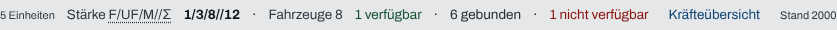

## Überblick

Lifeline Hub schreibt Zeiten, Dauern und die Stärke überall gleich. Dieses Kapitel ist das
Nachschlagewerk dafür: welche Form eine Uhrzeit, ein Zeitpunkt, eine Dauer und der Datenstand
haben, wie die Stärke zu lesen ist und welche Kürzel die App ohne Erklärung verwendet. Es richtet
sich an alle, die Lifeline Hub lesen oder bedienen.

## Abläufe

### Eine Stärke lesen

1. Im Bereich „Kräfte & Mittel“ „Einheiten“ öffnen. Über der Tabelle steht „Stärke F/UF/M//Σ“ und
   daneben die Stärke, etwa „1/2/5//8“.

   

2. Die Zahlen vor dem Doppelstrich nennen Führer, Unterführer und Mannschaft, die Zahl dahinter die
   Summe. „1/2/5//8“ heißt: ein Führer, zwei Unterführer, fünf Helferinnen und Helfer, zusammen acht.
3. Mit der Maus auf der Stärke steht die Schreibweise ausgeschrieben im Hinweis.

### Den Datenstand lesen

1. Im Kopf einer Seite steht neben dem Titel „Stand 1430“: Um 14:30 hat das Gerät die Daten zuletzt
   vom Server erhalten. Von einem anderen Tag steht der Tag davor, etwa „Stand 091430“.
2. Auf Lagebild, Großbild und Lagemonitor folgt ab einer Minute das Alter, etwa „Stand 1430 · vor
   2 min“. Ohne Netz endet die Angabe mit „· offline“: Die Zahlen sind vorgehalten und kommen nicht
   nach.

## Hintergrund

### Uhrzeit und Zeitpunkt

Zeiten stehen als taktische Datum-Zeit-Gruppe: ein ganzer Zeitpunkt als „101430okt26“ (Tag,
Uhrzeit, Monat, Jahr), in Listen „1430“ für heute und „091430“ für einen anderen Tag. Wer lieber
„10.10.26 14:30“ liest, stellt das im Profil um (Kapitel [Profil und Sicherheit](profil-sicherheit.md));
Einsatz und Organisation können es auch vorgeben (Kapitel
[Einsatz-Einstellungen](einsatz-einstellungen.md)). Die Uhr im Kopf, im Lagemonitor und im Großbild
folgt derselben Wahl: „1430“ oder „14:30“. Sie zeigt die Zeit des Geräts; eine Seite stellt keine
zweite Uhr neben ihren Titel. Ausdrucke folgen immer Einsatz und Organisation.

### Dauern

Eine Dauer steht in jeder Darstellung gleich und nie mit Doppelpunkt, damit sie nicht wie eine
Uhrzeit aussieht: „45 min“, „8 h“, „5 h 01 min“. Die Einsatzdauer des Einsatzes zählt ab einem Tag in
Tagen und Stunden, etwa „2 d 14 h“. Dauern von Kräften, Rhythmen und Grenzwerte laufen in Stunden
weiter („26 h 05 min“), weil sie neben Grenzwerten wie „Höchstdienst 12 h“ stehen. Abstände tragen
ein Vorwort: „vor 5 min“, „seit 1 h 05 min“, „in 25 min“, „noch 40 min“; unter einer Minute „gerade
eben“ bzw. „in < 1 min“. Eingaben in Dauerfeldern verstehen auch „7:30“, „7,5“ oder „90 min“.

### Stärke

Die Stärke folgt der BOS-Schreibweise „F/UF/M//Σ“. Jede Ansicht mit einer Stärke nennt diese
Schreibweise einmal sichtbar, als Spaltenkopf, Feldbeschriftung oder Zeile über der Gliederung. Ohne
erfasste Stärke steht „—“, nie „0/0/0//0“. Organisationen vergeben für Abschnitte eigene
Kurzbezeichnungen wie „EA 1.1“; die App übernimmt sie unverändert.

### Eingeführte Kürzel

Diese Kürzel stehen in der App ohne Erklärung an Ort und Stelle. Jedes andere schreibt die App aus,
etwa „Unterabschnitte“ statt „UA“.

| Kürzel | Bedeutung |
| --- | --- |
| BR | Bereitstellungsraum |
| Einh. | Einheiten |
| ETB | Einsatztagebuch |
| F/UF/M//Σ | Führer / Unterführer / Mannschaft // Summe (Stärke) |
| FMS, S1–S9 | Funkmeldesystem und seine Status 1 bis 9 |
| Fzg. | Fahrzeuge |
| Mtl. | Material |
| Pers. | Personen |
| Rückm. | Rückmeldung |
| SK I–IV | Sichtungskategorie I bis IV |
| UHS | Unfallhilfsstelle |

## Grundlagen und Quellen

- Die taktische Datum-Zeit-Gruppe folgt FwDV/DV 810 „Sprech- und Datenfunkverkehr“, Ausgabe 2018,
  Teil I, 5.1.1.12.
