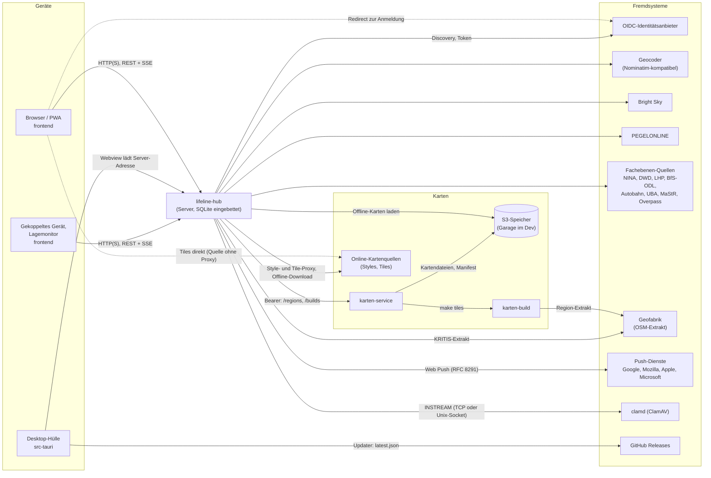

# 3. Kontextabgrenzung

Stand: 23.10.2026 (alpha dcc500f5).

Lifeline Hub ist ein einzelner Server (`lifeline-hub`), der Oberfläche, API und Live-Kanal
ausliefert. An der Systemgrenze stehen Menschen an Geräten und Fremdsysteme, die der Server
anfragt. Kein Fremdsystem ist für die Arbeit im lokalen Netz nötig: fällt eines aus, liefert der
Server einen gehaltenen Stand oder einen Status `offline` statt eines Fehlers
([`docs/fachebenen-quellen.md`](../fachebenen-quellen.md), Absatz „Offline-Verhalten“;
[Kapitel 1](01-einfuehrung-und-ziele.md), Q2). Alles hier steht im Code; eine Mail-Anbindung gibt
es nicht (kein SMTP-Crate in [`Cargo.toml`](../../Cargo.toml)).

## 3.1 Fachlicher Kontext

| Partner | Was ausgetauscht wird |
| --- | --- |
| Einsatzleitung, Führungspersonal, Stab, Beobachter | Erfassen und lesen Einsatzdaten in Browser, PWA oder Desktop-Hülle; Rechte nach Rolle im Einsatz ([Kapitel 1](01-einfuehrung-und-ziele.md), Stakeholder) |
| Einsatzkräfte an gekoppelten Geräten | Erfassen für genau eine Stelle eines Einsatzes ohne Personenkonto (Spec [`geraete-kopplung`](../../openspec/specs/geraete-kopplung/spec.md)) |
| Lagemonitor | Zeigt das Lagebild ohne Bedienung und ohne personenbezogene Daten (Spec [`lagemonitor`](../../openspec/specs/lagemonitor/spec.md)) |
| Administration | Benutzer, Organisation, Karten, Aufbewahrung, Zugangsprotokoll |
| Identitätsanbieter der Organisation | Anmeldung per OIDC als Alternative zu Passwort und Passkey |
| Amtliche und offene Datenquellen | Warnungen, Wetter, Pegel, Strahlung, Verkehr, Luftqualität, Energieanlagen, kritische Infrastruktur als Fachebenen der Lagekarte ([`docs/fachebenen-quellen.md`](../fachebenen-quellen.md)) |
| Karten- und Ortsdienste | Hintergrundkarten online und als Offline-Datei, Ortsnamen zu Koordinaten und Adresssuche |
| Push-Dienste der Browser-Hersteller | Benachrichtigungen bei geschlossener App, nur mit Schalter `--web-push` ([`docs/betrieb/web-push.md`](../betrieb/web-push.md)) |

## 3.2 Technischer Kontext

Alle Pfeile zeigen die Richtung des Verbindungsaufbaus. Der Server baut jede ausgehende
Verbindung selbst auf; eingehend nimmt er nur Anfragen der Geräte an.

## 3.3 Schnittstellen

| Schnittstelle | Richtung | Protokoll | Code |
| --- | --- | --- | --- |
| Oberfläche (eingebettetes `frontend/dist`) | Gerät → Server | HTTP(S), statische Dateien | `src/static_files.rs` (`rust-embed`) |
| REST-API `/api/…` | Gerät → Server | HTTP(S), JSON; Vertrag als OpenAPI | `src/routes/`, `src/api_doc.rs`, `frontend/src/api/` |
| Live-Kanal | Server → Gerät (vom Gerät geöffnet) | Server-Sent Events, Ereignisnamen als `LiveEvent` | `src/live/`, `frontend/src/live/` |
| TLS am Server (optional) | Gerät → Server | rustls; eigenes Zertifikat oder selbstsigniertes per `rcgen` | `src/tls/`, `--tls`; [`docs/betrieb-tls.md`](../betrieb-tls.md) |
| Reverse-Proxy davor (optional) | Proxy → Server | HTTP mit `X-Forwarded-For`/`-Proto` | `--trusted-proxies` in `src/config.rs`; [`docs/betrieb/env-registry.md`](../betrieb/env-registry.md) |
| Desktop-Hülle | Hülle → Server | Webview lädt die https-Adresse; Anmeldung im Systembrowser über `POST /api/auth/app-code` | [`src-tauri/AGENTS.md`](../../src-tauri/AGENTS.md) |
| Update der Desktop-Hülle | Hülle → GitHub | HTTPS, `latest.json` am Release (stabil) bzw. Tag `desktop-alpha` | `src-tauri/tauri.conf.json` (`plugins.updater`), `src-tauri/src/update.rs` |
| OIDC-Anmeldung | Server → IdP (Discovery, Token); Browser → IdP (Redirect) | OpenID Connect über HTTPS, ohne Redirect-Folgen, Antwort gedeckelt | `src/auth/oidc/`, `LIFELINE_OIDC_*` in `src/config.rs`; [`docs/betrieb-oidc.md`](../betrieb-oidc.md) |
| Online-Kartenquellen | Server → Anbieter (Proxy, Vorgabe an) oder Browser → Anbieter (Proxy pro Quelle abgeschaltet) | HTTPS, Style-JSON, TileJSON, Tiles, Sprites, Glyphs | `src/karte/proxy.rs`, `src/karte/tile_cache.rs`, `src/karte/registry/`, `src/routes/karte.rs`; Vorschläge `default_online_styles` in `src/config.rs` |
| Offline-Karten laden | Server → Download-URL aus dem Katalog | HTTPS, Streaming mit SSRF-Schutz und Prüfsumme | `src/karte/download.rs`, `src/karte/auto_aktualisierung.rs` |
| Katalog-Manifest der Offline-Karten | Server → Manifest-URL | HTTPS, JSON, höchstens 1 MiB | `src/karte/katalog.rs`; Override `--offline-katalog-manifest-url` |
| karten-service | Server → karten-service | HTTP mit Bearer-Token; `GET /regions`, `GET`/`POST /builds` | `src/routes/karte.rs` (`KARTEN_SERVICE_CLIENT`), `karten-service/src/api.rs`, Vertragstypen `crates/karten-katalog` |
| Kartenspeicher | karten-service → S3 | S3-API; Lesepfad öffentlich über `KS_BASE_URL` | `karten-service/src/storage/`; Dev-Instanz in [`compose.yml`](../../compose.yml), [`garage.toml`](../../garage.toml) |
| Kartenbau | karten-service → `karten-build` → Geofabrik | `make tiles` mit Planetiler-Abbild, Region-Extrakt per HTTPS | `karten-service/src/build/`, [`karten-build/README.md`](../../karten-build/README.md) |
| Geocoding und Ortssuche | Server → Geocoder | HTTPS, Nominatim-API; 1 Anfrage/s, Zeitlimit 1,5 s | `src/geocoding/` (`NOMINATIM_DEFAULT`, URL je Organisation überschreibbar) |
| Wetter | Server → Bright Sky | HTTPS, `/alerts`, `/weather`, `/current_weather` | `src/wetter/abruf.rs`, `BRIGHTSKY_BASIS_URL` in `src/karte/mod.rs` |
| Pegel | Server → PEGELONLINE | HTTPS, Stationen, Messreihe `W`, Vorhersage `WV` | `src/pegel/abruf.rs`, `src/pegel/vorhersage.rs`, `PEGELONLINE_BASIS_URL` in `src/karte/mod.rs` |
| Fachebenen | Server → NINA, DWD, LHP, BfS-ODL, Autobahn, UBA, MaStR, Overpass | HTTPS, JSON/GeoJSON/WFS; normalisiert zu GeoJSON | `src/karte/quellen.rs`; Tabelle der Quellen in [`docs/fachebenen-quellen.md`](../fachebenen-quellen.md) |
| KRITIS-Extrakt | Server → Geofabrik | HTTPS, `HEAD` und Download einer `.osm.pbf` | `src/karte/kritis/scheduler.rs`; `--kritis-extrakt-url` in `src/config.rs` |
| Web Push | Server → Push-Dienst | HTTPS, verschlüsselt nach RFC 8291; nur bekannte Dienste (`PUSH_DIENSTE`) | `src/web_push/`; [`docs/betrieb/web-push.md`](../betrieb/web-push.md) |
| Virenscan der Uploads | Server → clamd | ClamAV `INSTREAM` über TCP oder `unix:`-Socket; ohne Adresse kein Scan | `clamd_verbinden` in `src/anhang/mod.rs`; [`src/AGENTS.md`](../../src/AGENTS.md), Abschnitt „Backend — ClamAV-Upload-Scan“ |
| Sicherung | Server → lokales Verzeichnis | Datei, optional mit `age` verschlüsselt | `src/backup/`; [`docs/betrieb/backup-restore.md`](../betrieb/backup-restore.md) |

Jede ausgehende Antwort, die der Server ganz einliest, läuft über eine Größenobergrenze
(`src/http_begrenzt.rs`). Wie Ports, Prozesse und Speicherorte verteilt sind, steht in
[Kapitel 7](07-verteilungssicht.md), die Abläufe über diese Schnittstellen in
[Kapitel 6](06-laufzeitsicht.md).
