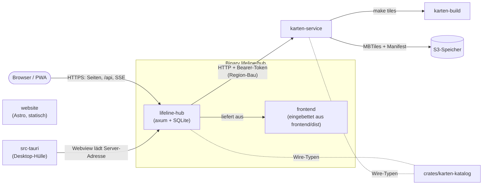
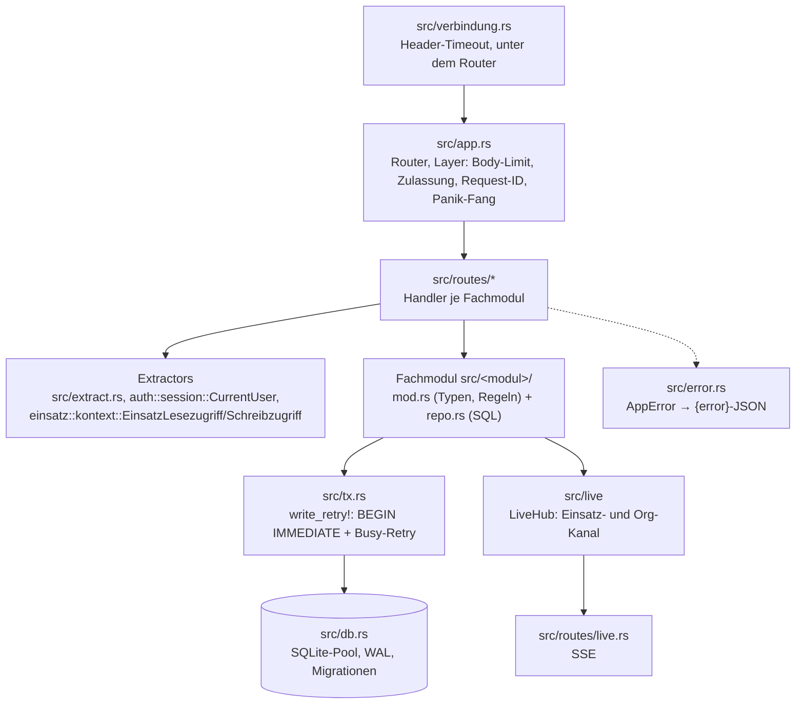
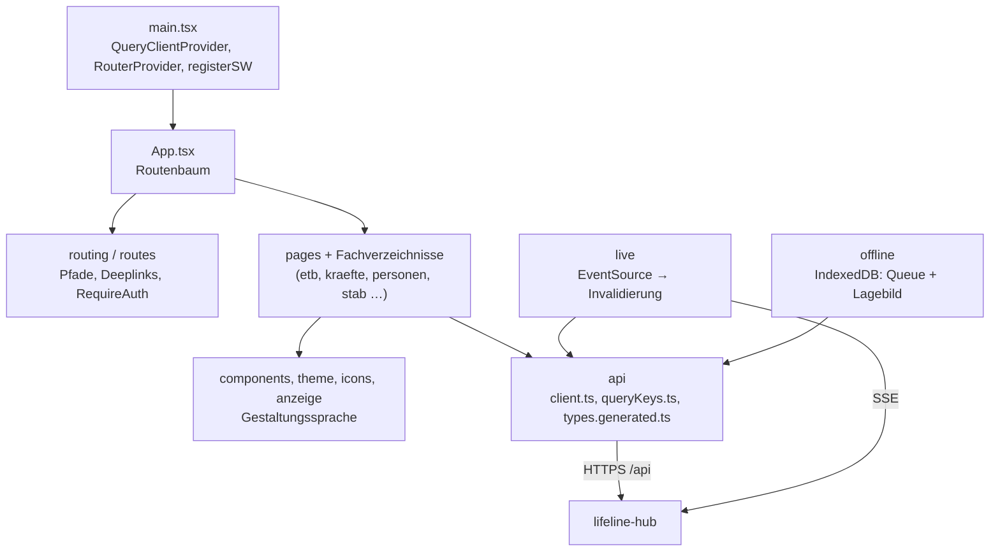

# 5. Bausteinsicht

Stand: 23.10.2026 (alpha dcc500f5).

Dieses Kapitel nennt jeden Baustein des Repos mit einem Satz Zweck und seinen Schnittstellen.
Der Wächter `scripts/check-architektur.sh` verlangt, dass jedes Modul unter `src/`, jedes
Verzeichnis unter `frontend/src/`, jedes Crate unter `crates/` und jedes Teilprojekt hier steht
(Mitänderungsregel in [docs/architektur/AGENTS.md](AGENTS.md)). Äußere Nachbarn und
Fremddienste stehen in der [Kontextabgrenzung](03-kontextabgrenzung.md), Abläufe über mehrere
Bausteine in der [Laufzeitsicht](06-laufzeitsicht.md), Prozesse und Speicherorte in der
[Verteilungssicht](07-verteilungssicht.md).

## 5.1 Ebene 1: Whitebox Gesamtsystem

| Baustein | Verantwortung | Schnittstellen | Code |
| --- | --- | --- | --- |
| Backend `lifeline-hub` | Ein Binary: REST-API unter `/api`, Live-Kanal per SSE, SQLite-Datenbank, Hintergrund-Scheduler (u. a. Erinnerung, Purge, Sicherung) und Auslieferung des Frontends | HTTP(S), `GET /api/einsaetze/{id}/live` und `GET /api/live` (`src/routes/live.rs`), CLI-Subkommandos `backup`/`restore` (`src/config.rs`) | `src/`, Start `src/main.rs` |
| `frontend` | React-19/antd-6-Oberfläche als PWA (`frontend/package.json`); Stabsoberfläche und Gerätehülle | ruft `/api` über `frontend/src/api/client.ts`, Live über `EventSource` (`frontend/src/live/liveVerbindung.ts`) | `frontend/src/` |
| Desktop-Hülle `src-tauri` | Tauri-2-Crate `lifeline-desktop`, lädt die https-Adresse des Servers, keine Anwendungslogik | Commands nach `src-tauri/build.rs`, Deeplink `lifeline://verbinden`, `POST /api/auth/app-code[/einloesen]` | `src-tauri/` ([AGENTS.md](../../src-tauri/AGENTS.md)) |
| `karten-service` | Zentraler Dienst, der Offline-Kartenregionen baut und in S3 ablegt | `/regions`, `/builds`, `/builds/{id}`, `/zeitplan`, `/healthz` (`karten-service/src/api.rs`) | `karten-service/` |
| `karten-build` | Bau-zeitiges Erzeugen der Shortbread-MBTiles mit Planetiler, nie zur Laufzeit der App | `make tiles AREA=…`, `make validate` (`karten-build/README.md`) | `karten-build/` |
| `crates/karten-katalog` | Geteilte Wire-Typen des Offline-Kartenkatalogs und der Bau-Jobs | Lib-Crate, Feature `schema` für den Typ-Codegen (`crates/karten-katalog/Cargo.toml`) | `crates/karten-katalog/src/lib.rs` |
| `website` | Marketing-Seite und Anwenderdoku, eigenständig, nicht im Binary | Cloudflare Pages, liest `docs/anwender/kapitel/` | `website/` ([AGENTS.md](../../website/AGENTS.md)) |

Belege: Der Release-Build bettet `frontend/dist` per `rust-embed` ein, der Debug-Build liest vom
Dateisystem (`src/static_files.rs`); unbekannte Pfade ohne Dateiendung fallen auf `index.html`
zurück, eingehängt als Router-Fallback in `src/app.rs`. Der Workspace umfasst `.`,
`crates/karten-katalog`, `karten-service` und `src-tauri` (`Cargo.toml`). Die Kopplung an den
`karten-service` ist optional: ohne `LIFELINE_KARTEN_SERVICE_URL` und
`LIFELINE_KARTEN_SERVICE_TOKEN` ist der Region-Bau aus (`src/config.rs`); die Proxy-Routen
`/api/karte/offline-karten/bauen|baubare-regionen|bau-status` stehen in `src/app.rs`. Der
`karten-service` ruft `make tiles` im Verzeichnis von `karten-build`
(`karten-service/src/build/make_runner.rs`) und schreibt über `karten-service/src/storage/s3.rs`.

## 5.2 Ebene 2: Backend `lifeline-hub`

Regeln des Backends: [src/AGENTS.md](../../src/AGENTS.md) (Statuscodes, Eingabegrenzen,
Typ-Codegen, Anhänge, Schutzköpfe, Org-Ereignisse, Benachrichtigungen, Aufbewahrung, ClamAV).

### Schichtung einer Anfrage

- **Router:** Alle Routen stehen flach in `build_router_mit` (`src/app.rs`), die Handler in
  `src/routes/` (eine Datei je Ressource, gemeinsame Helfer in `src/routes/support.rs`).
  Die Demo-Routen gibt es nur mit `RouterOptionen::demo_daten` (`--demo-daten`); die Web-Push-Routen
  sind immer eingehängt und antworten ohne `--web-push` aus dem Handler mit 404.
- **Zugriff:** Jede `/api/einsaetze/{id}/…`-Route zieht `EinsatzKontext`; der Extractor prüft
  immer die Org-Zugehörigkeit (`src/einsatz/kontext.rs`). Gerätesitzungen begrenzt
  `CurrentUser` auf eine Routenliste (`src/geraet/mod.rs`, `darf_route`).
- **Schreiben:** `write_retry!` holt den Schreib-Lock am `BEGIN` und wiederholt bis
  `MAX_VERSUCHE` = 4, danach 503 (`src/tx.rs`).
- **Live:** `LiveEvent` (Einsatz-Kanal, gefiltert nach Modulrecht über `modul_keys`) und
  `OrgLiveEvent` (`einsatzliste`, `stammdaten`, `org_benachrichtigung`) in `src/live/mod.rs` und
  `src/live/org.rs`; `stammdaten` sendet eine Middleware nach jedem erfolgreichen Schreiben auf
  einen Stammdaten-Pfad (`src/routes/live.rs`). Das Frontend filtert auf dieselben Wire-Namen
  (`frontend/src/api/queryKeys.ts`).
- **Fachmodul-Form:** Ein Modul trägt in `mod.rs` Typen, Grenzen und reine Regeln, in `repo.rs`
  (oder `repo/`) die Abfragen; ETB-Einträge aus anderen Modulen schreibt `etb::repo::anlegen_tx`; der
  eine INSERT steht in `einfuegen` (`src/etb/repo.rs`).

In den Tabellen unten bedeutet „Routen“ den Pfad-Präfix aus `src/app.rs`, „Live“ den Wire-Namen
aus `src/live/mod.rs`. `{id}` ist die Einsatz-ID.

### Einsatz & ETB

| Pfad | Zweck | Schnittstellen |
| --- | --- | --- |
| `src/einsatz` | Einsatz-Lebenszyklus, Rollen, Modulsichtbarkeit, Einstellungen, Zugriffs-Extractor, Nummernvergabe, Purge-Scheduler und Schwärzung | Routen `/api/einsaetze`, `…/{id}/modul-zaehler`, `…/{id}/lagekennzahl-wahl`; Live `einsatz` |
| `src/einsatz_vorlage` | Org-Katalog „Einsatz-Vorlagen“: Modulsatz, der beim Anlegen Module ausblendet | `/api/einsatz-vorlagen`; nutzt `einsatz::repo::anlegen_tx` |
| `src/einsatzabschnitt` | Abschnittsbaum mit Leiter, Fläche und Sprechgruppen; schreibt System-ETB beim Anlegen | `…/{id}/abschnitte`; Live `abschnitt` |
| `src/etb` | Einsatztagebuch: Eintragstypen, Einfügen als einzige Stelle, Lesemarke, Zähler | `…/{id}/etb`; Live `etb` |
| `src/etb_baustein` | Org-Katalog der ETB-Textbausteine, Seed für neue Organisationen | `/api/etb-bausteine` |
| `src/stichwort` | Org-weite Einsatzstichwort-Vorschläge, koppelbar an Einsatz-Vorlagen | `/api/stichwort-vorschlaege` |

### Lage & Karte

| Pfad | Zweck | Schnittstellen |
| --- | --- | --- |
| `src/karte` | Fachebenen-Aggregator (NINA, DWD, PEGELONLINE, KRITIS u. a.), Style-/Tile-Proxy mit SSRF-Schutz, MBTiles, Offline-Karten-Registry und -Download | `/api/karte/…`; ruft `karten-service`; Cache in `src/cache_db.rs` |
| `src/karte_hintergrundbild` | Hochgeladene Hintergrundbilder (PNG/JPEG) mit vier Eckkoordinaten | `…/{id}/karte/hintergrundbilder`; Live `karte_bild` |
| `src/karten_ansicht` | Einsatzweit geteilte, benannte Kartenkonfiguration | `…/{id}/karten-ansichten`; Live `karten_ansicht` |
| `src/lage_snapshot` | Unveränderlicher Stand des vollen Lagebilds als JSON-Dokument | `…/{id}/lage-snapshots`; Live `lage_snapshot` |
| `src/lage_zone` | Freie Gefahren- und Absperrzonen als GeoJSON | `…/{id}/zonen`; Live `lage_zone` |
| `src/freies_zeichen` | Taktische Zeichen ohne Fachobjekt (`zeichen_spec`) | `…/{id}/freie-zeichen`; Live `freies_zeichen` |
| `src/gefahr` | Gefahrengebiete aus Zonen mit Gefahrenmatrix und Beurteilung | `…/{id}/gefahrengebiete`; Live `gefahr` |
| `src/geocoding` | Peilung (offline), Reverse-Geocoding und Ortssuche über einen Nominatim-kompatiblen Dienst mit Cache und Drossel | `/api/ort-suche`, `/api/ort-vorschau`, `…/{id}/ort-suche`, `…/{id}/ort-vorschau`, `…/{id}/karte/ort-suche` |
| `src/schaden` | Schadenregister mit Statusmaschine, Kennzahlen, Export und Anhängen | `…/{id}/schaeden`; Live `schaden` |
| `src/tier` | Tierregister mit Status, Halterbezug und Anhängen | `…/{id}/tiere`; Live `tier` |
| `src/pegel` | Maßgebliche PEGELONLINE-Pegel mit Trend und Vorhersage-Vorschlag | `…/{id}/pegel`; Cache über `karte::cache` |
| `src/wetter` | DWD-Warnungen, 24-h-Vorhersage und Messwerte über Bright Sky | `…/{id}/wetter` |

### Kräfte & Mittel

Regeln: [frontend/src/kraefte/AGENTS.md](../../frontend/src/kraefte/AGENTS.md) (Client und Server).

| Pfad | Zweck | Schnittstellen |
| --- | --- | --- |
| `src/einheit` | Einheiten im Einsatz bilden (auch aus Vorlage oder Nachforderung), zuordnen, Status, Stärke, Einheitstypen | `…/{id}/einheiten`, `/api/einheit-typen`; Live `einheit` |
| `src/einheit_vorlage` | Org-Katalog stehender Einheiten mit Untereinheiten, Fahrzeugen und Stammbesetzung | `/api/einheit-vorlagen` |
| `src/fahrzeug` | Fahrzeugstamm, Status-Katalog, Disposition und Besatzung im Einsatz | `/api/fahrzeuge`, `/api/fahrzeug-status`, `…/{id}/fahrzeuge`; Live `fahrzeug` |
| `src/personal` | Personalstamm, Qualifikationen, Status-Katalog und Disposition | `/api/personal`, `/api/qualifikationen`, `/api/personal-status`, `…/{id}/personal`; Live `personal` |
| `src/material` | Materialstamm, Disposition, Aufteilen und Ort im Einsatz | `/api/material`, `…/{id}/material`; Live `material` |
| `src/kraefte_disposition.rs` | Gemeinsamer Baustein „disponieren und zuordnen in einer Transaktion“, alles oder nichts mit Gründen je Zeile (422) | genutzt u. a. von `src/routes/einsatz_personal.rs`, `einsatz_fahrzeug.rs`, `einsatz_einheit.rs`, `abloesung.rs`, `src/einheit/aus_vorlage.rs`; `AppError::Zeilen` |
| `src/kraefte_disposition` | Nur die Tests zu `src/kraefte_disposition.rs` (`tests.rs`) | — |
| `src/entlassung.rs` | Lebenszustand einer Kraft: entlassen oder storniert statt löschen | genutzt von Einheit, Fahrzeug, Personal, Material, Bereitstellungsraum |
| `src/zeitachse` | Append-only Kräfte-Zeitachse (Alarmierung, Eintreffen, Ablösung, Entlassung), Perioden beim Lesen | `…/{id}/einheiten/zeitachse`, `…/{id}/personal/zeitachse`; feuert `einheit` |
| `src/abloesung` | Schichten von Einheiten: Fälligkeit beim Lesen berechnet, Vollzug, Vorgaben je Abschnitt | `…/{id}/abloesungen`; Live `abloesung` |
| `src/schichtmodell` | Org-Schichtmodelle (Rhythmus oder Wechselzeiten), Kopie am Einsatz | `/api/schichtmodelle` |
| `src/bereitstellungsraum` | Bereitstellungsräume mit Statusmaschine, Belegung, Eintreffen und Abruf | `…/{id}/bereitstellungsraeume`; Live `bereitstellungsraum` |
| `src/staerke.rs` | Taktische Stärke Führer/Unterführer/Mannschaft, Summe berechnet | genutzt u. a. von Fahrzeug, Einheiten-Vorlage, UHS, Verpflegung |
| `src/katalog.rs` | Geteilte Grundlagen der Status-Kataloge (Dienststatus, Semantik-Kategorie, TETRA-Betriebsart) | genutzt u. a. von Fahrzeug, Personal, Material, Sprechgruppe, Einheit |

### Betroffene & Betreuung

Regeln: [frontend/src/personen/AGENTS.md](../../frontend/src/personen/AGENTS.md),
[frontend/src/betreuung/AGENTS.md](../../frontend/src/betreuung/AGENTS.md).

| Pfad | Zweck | Schnittstellen |
| --- | --- | --- |
| `src/person` | Betroffene: Sichtung, Verbleib, Transport, Maßnahmen, Verletzungen, Vermisstenabgleich, Anhänge | `…/{id}/personen`, `…/personen/{pid}/…`; Live `person` |
| `src/uhs` | Unfallhilfsstellen mit Plätzen, Belegung, Kräften, Grundriss und Anhängen | `…/{id}/uhs`; Live `uhs` |
| `src/betreuung` | Evakuierungsbezirke und Betreuungsstellen als Mengen mit append-only Meldereihen | `…/{id}/betreuung`, `…/{id}/evakuierung`; Live `betreuung`, `evakuierung` |
| `src/unterkunft` | Richtwerte des Unterkunftsrechners: Basis aus `richtwerte_basis.json`, Werte je Organisation und Einsatz | `/api/unterkunft-richtwerte`, `/api/org-unterkunft-richtwerte/{schluessel}`, `…/{id}/unterkunft-richtwerte` |
| `src/verpflegung` | Verpflegungszeitfenster, erfasster Bedarf, Ausgaben, Stellen und Org-Vorlagen | `…/{id}/verpflegung`, `/api/verpflegung-vorlagen`; Live `verpflegung` |

### Kommunikation & Meldungen

| Pfad | Zweck | Schnittstellen |
| --- | --- | --- |
| `src/kommunikation` | Gemeinsamer Unterbau: Quittung und Vollzug, polymorphe Bezüge, Auto-Fristen | genutzt von Chat, Erinnerung, Auftrag, Meldung, Nachforderung, Presse, Infotelefon |
| `src/chat` | Kanäle und Nachrichten je Einsatz, Erwähnungen, Tombstones | `…/{id}/chat/…`; Live `chat` |
| `src/erinnerung` | Fristen und Wiedervorlagen, Fälligkeit beim Lesen, Scheduler | `…/{id}/erinnerungen`; Live `erinnerung`, `sofortmeldung` |
| `src/auftrag` | Aufträge top-down: Empfänger-Quittung, Vollzug, ETB-Anordnung | `…/{id}/auftraege`; Live `auftrag` |
| `src/befehl` | Befehle nach Vorlage (Registry synchron zu `frontend/src/befehle/vorlagen.ts`) | `…/{id}/befehle`; Live `befehl` |
| `src/meldung` | Eingehende Meldungen bottom-up: Nachrichtenvordruck, Triage, Korrektur, Lagemeldungen | `…/{id}/meldungen`, `…/{id}/lage/…`; Live `meldung`, `sofortmeldung` |
| `src/nachforderung` | Nachforderung von Kräften und Mitteln mit linearem Bedarfsstatus | `…/{id}/nachforderungen`; Live `nachforderung` |
| `src/benachrichtigung` | Eine Stelle entscheidet Empfänger, schreibt je Empfänger eine Zeile, stellt zu | `/api/benachrichtigungen`; Live `benachrichtigung`, `org_benachrichtigung` |
| `src/web_push` | Web Push bei geschlossenem Tab, nur mit `--web-push`, RFC-8291-Verschlüsselung | `/api/web-push`; aus `benachrichtigung::melden` |
| `src/externe_stelle` | Org-Katalog externer Stellen als Vorschlagsquelle (Speicherform Text) | `/api/externe-stellen` |

### Stab & Führung

Regeln: [frontend/src/stab/AGENTS.md](../../frontend/src/stab/AGENTS.md),
[frontend/src/fuehrung/AGENTS.md](../../frontend/src/fuehrung/AGENTS.md),
[frontend/src/lagebesprechung/AGENTS.md](../../frontend/src/lagebesprechung/AGENTS.md).

| Pfad | Zweck | Schnittstellen |
| --- | --- | --- |
| `src/stab` | Besetzung S1–S6, Checkliste, Kommunikationsplan und Fernmeldeskizze | `…/{id}/stab`; Live `stab`, `fernmeldewesen` |
| `src/fuehrung` | Geschlossener Katalog der Führungsfunktionen (FwDV 100) mit Org-Labels | `/api/fuehrungsfunktionen`, `/api/org-fuehrungsfunktionen/{funktion}` |
| `src/lagebesprechung` | Termin, Abschluss mit Entschluss und Verlauf, eigenes Modul neben dem Stab | `…/{id}/lagebesprechung[en]`; Live `lagebesprechung` |
| `src/lagebericht` | Lageberichte nach Vorlage (Registry synchron zu `frontend/src/lageberichte/vorlagen.ts`) | `…/{id}/lageberichte`; Live `lagebericht` |
| `src/vorlagendokument` | Gemeinsamer Kern von Befehl, Lagebericht, Pressemitteilung: Entwurf, Freigabe als ETB-Snapshot, Fortschreibung, Anlagen, Verteiler | von `src/befehl`, `src/lagebericht`, `src/presse` genutzt |
| `src/presse` | Presse-Log und Pressemitteilungen S5 | `…/{id}/stab/medienkontakte`, `…/stab/pressemitteilungen`; Live `presse` |
| `src/infotelefon` | Bürgertelefon S5: Anrufprotokoll mit Rückrufbedarf | `…/{id}/stab/infotelefon`; Live `infotelefon` |
| `src/sprechgruppe` | TETRA-Sprechgruppen im Stamm und einsatzlokal, Zuordnung zu Zielen | `/api/sprechgruppen`, `…/{id}/sprechgruppen` |

Die Führungsstelle eines Einsatzes liegt in `src/einsatz` (`fuehrungsstelle.rs`, Routen
`…/{id}/fuehrungsstelle`).

### Geräte

Regeln: [frontend/src/geraet/AGENTS.md](../../frontend/src/geraet/AGENTS.md).

| Pfad | Zweck | Schnittstellen |
| --- | --- | --- |
| `src/geraet` | Gerätekopplung per Code, Gerätekonto, Funktionsansicht, Stellenbindung, Routen-Whitelist | `…/{id}/geraete`, `POST /api/geraete/koppeln`, `…/{id}/lagemonitor` |

### Auth & Organisation

Regeln: [frontend/src/auth/AGENTS.md](../../frontend/src/auth/AGENTS.md) (Client und Server).

| Pfad | Zweck | Schnittstellen |
| --- | --- | --- |
| `src/auth` | Passwort, TOTP, WebAuthn, OIDC, Hüllen-Anmeldung (PKCE), Sitzungen, Drosseln, Anmelde- und Admin-Spur, Benutzerverwaltung | `/api/auth/…`, `/api/benutzer`, `/api/zugangsprotokoll/…` |
| `src/org` | Org-Einstellungen, Modul-Vorgaben, Logo, Aufbewahrungsfristen je Kategorie | `/api/organisation`, `/api/org-einstellungen`, `/api/org-modul-einstellungen` |
| `src/benutzer_einstellungen` | Schlüssel/Wert-Fach je Benutzer mit Whitelist (erster Nutzer: Sprungpalette) | `/api/benutzer-einstellungen` |

### Aufbewahrung & Dokumente

| Pfad | Zweck | Schnittstellen |
| --- | --- | --- |
| `src/anhang` | Generische Anhänge als BLOB in SQLite: Allowlist, 25 MiB, Scan, Vorschaubilder, Audit | `…/{id}/anhaenge`; von ETB, Person, Tier, Schaden, UHS, Dokument genutzt |
| `src/dokument` | Dokumentenablage eines Einsatzes mit Kategorie und Bezug, Bytes in `anhang` | `…/{id}/dokumente`; Live `dokument` |
| `src/aufbewahrung` | Lesender Archivpfad des Org-Admins: Übersicht, pseudonyme Archivakte, Wiederherstellen, Schwärzungsantrag | `/api/aufbewahrung` |
| `src/backup` | Konsistente Sicherung (auch verschlüsselt mit `age`), Download, Restore, Scheduler | `GET /api/backup`, CLI `backup`/`restore` |
| `src/storno.rs` | Soft-Delete einer Zeile genau einmal, mit 404/409-Semantik | von den Fachmodulen genutzt |

### Plattform & Infrastruktur

| Pfad | Zweck | Schnittstellen |
| --- | --- | --- |
| `src/main.rs` | Start: Konfiguration, DB, Migrationen, Scheduler, TLS, Server, Herunterfahren | Binary `lifeline-hub` |
| `src/lib.rs` | Modulbaum des Crates | — |
| `src/config.rs` | CLI- und ENV-Konfiguration (`clap`), maskierte Geheimnisse, Subkommandos | `LIFELINE_*`-Variablen |
| `src/lizenz.rs` | Lizenztext aus `LICENSE`, eingebettet; Hinweis bei `--help` und jedem Start, Volltext beim ersten Start | Subkommando `lifeline-hub lizenz` |
| `src/app.rs` | `AppState`, Router mit allen Routen und Layern, statischer Fallback | `build_router`, `build_router_mit` |
| `src/routes` | HTTP-Handler je Ressource, gemeinsame Helfer in `support.rs` | alle `/api`-Routen |
| `src/extract.rs` | Extractors mit `{error}`-Vertrag (`JsonBody`, `PfadParam`) und Quell-IP hinter vertrauten Proxys | von allen Handlern genutzt |
| `src/error.rs` | `AppError` → JSON `{ "error": … }` mit Statuscode, Zeilenfehler (422) | Statuscode-Konvention in `src/AGENTS.md` |
| `src/db.rs` | SQLite-Pool (WAL, Foreign Keys, `secure_delete`), Migrationen, Test-Pools | `connect`, `migrate` |
| `src/db` | Physisches Überschreiben geschwärzter Werte, LIKE-Suche der Listen | `db::suche::like_muster` |
| `src/tx.rs` | Schreibtransaktion mit `BEGIN IMMEDIATE` und Busy-Retry | Makro `write_retry!` |
| `src/live` | Broadcast je Einsatz mit Replay-Ring, Org-Kanal, Stromgrenzen | `LiveHub`, `LiveEvent`, `OrgLiveEvent` |
| `src/api_doc.rs` | OpenAPI-Schemas als Quelle der Frontend-Typen | `frontend/src/api/types.generated.ts`, `scripts/check-typ-codegen.sh` |
| `src/static_files.rs` | Eingebettetes Frontend, MIME, Cache-Header, SPA-Fallback | Router-Fallback |
| `src/cache_db.rs` | Eigene SQLite-Datei für Nachschlage-Caches, getrennt vom operativen Writer | genutzt von `src/karte`, `src/routes/pegel.rs`, `wetter.rs`, `ort_vorschau.rs` |
| `src/tls` | HTTPS-Zertifikat in Präzedenz BYO → Cache → mkcert → rcgen | Start in `src/main.rs` |
| `src/verbindung.rs` | Schutz unter dem Router: Header-Lese-Timeout gegen Slow Loris | hyper-Ebene |
| `src/zulassung.rs` | Zeitbudget und Höchstzahl gleichzeitiger Requests, Lastabwurf | Layer in `src/app.rs` |
| `src/transfer.rs` | Upload- und Download-Grenzen für große Transfers; volle Upload-Grenze → 503 mit `Retry-After` | `UploadGrenze`, `DownloadGrenze` |
| `src/http_begrenzt.rs` | Begrenztes Einlesen fremder HTTP-Antworten | Geocoder, Fachebenen, OIDC |
| `src/log_drossel.rs` | Sammelzeilen für fremdausgelöste Logereignisse | Lastabwurf, Pool, 503 |
| `src/zeit.rs` | Ein Zeitformat für DB und Wire: UTC, sekundengenau | überall |
| `src/zeitdarstellung.rs` | Zeitpunkte in fertigen Servertexten (ETB-Sätze, Hinweise) in der Darstellung von Einsatz bzw. Organisation, Vorgabe taktisch | Gegenstück `frontend/src/anzeige/zeitDarstellung.ts` |
| `src/uhrzeit.rs` | Wanduhrzeit `HH:MM` ohne Datum und Zone | Verpflegungsplan |
| `src/wire_enum.rs` | Makro `wire_enum!`: Enum, Serde, Schema und `as_str()` aus einer Liste | Live-Ereignisse, Domänen-Enums |
| `src/datentraeger` | Prüfung der Datenträgerverschlüsselung beim Start und stündlich | `GET /api/system/datentraeger` |
| `src/versionsstand` | Versionsstand der Instanz, Versionswechsel erkennen | `/api/versionsstand` |
| `src/demo` | Übungseinsatz samt Stammdaten einspielen und entfernen, nur mit `--demo-daten` | `/api/demo-daten` |
| `src/dev` | Seed-Benutzer für die Entwicklung, nur mit Feature `dev-seeds` (`src/lib.rs`) | `/api/dev/users` |
| `src/test_log.rs` | Fängt Log-Ausgabe in Tests ein, nur unter `cfg(test)` | Tests |

## 5.3 Ebene 2: `frontend`

Regeln: [frontend/AGENTS.md](../../frontend/AGENTS.md) (Gestaltungssprache, UI-Form,
Bedien-Leitlinie, Erfassung, Deeplinks, Query-Keys, Browserspeicher); Bereichsdateien sind in
den Tabellen verlinkt.

### Struktur

- **Einstieg:** `frontend/src/main.tsx` baut den Router mit `createBrowserRouter` aus dem
  Routenbaum in `frontend/src/App.tsx` und registriert den Service Worker (`virtual:pwa-register`).
- **API-Schicht:** Ein Modul je Ressource in `frontend/src/api/`; die Response-Typen sind aus
  Rust generiert (`types.generated.ts`, Barrel `types.ts`, Regel „Typ-Codegen“ in
  `src/AGENTS.md`). Query-Keys und Live-Zuordnung in `frontend/src/api/queryKeys.ts`.
- **Live:** Höchstens eine `EventSource` je Tab, Einsatz- oder Org-Strom
  (`frontend/src/live/liveVerbindung.ts`, `frontend/src/live/einsatzStromStore.ts`).
- **Offline:** Schreib-Queue in der IndexedDB `lifeline-offline` (`frontend/src/offline/queue.ts`)
  und ein eigener Lagebild-Speicher daneben (`frontend/src/offline/lagebildSpeicher.ts`).
- **Gestaltung:** Bausteine der „Instrumententafel“ in `frontend/src/components/instrument/`;
  das Design System wird aus dem Code erzeugt (`frontend/scripts/design-system/`, Wächter
  `frontend/src/designSystem.guard.test.ts`).

### Grundgerüst und Querschnitt

| Pfad | Zweck | Gegenstück im Backend |
| --- | --- | --- |
| `frontend/src/routing` | Deeplink-Builder an einer Stelle, Pfadwahl Stabsoberfläche/Gerätehülle, Query-Param-Selektion | Routen des Routers |
| `frontend/src/routes` | `RequireAuth`: Weiterleitung ohne Sitzung, Gerätehülle abschirmen | `src/auth`, `src/geraet` |
| `frontend/src/api` | API-Client, Ressourcen-Module, generierte Typen, `openapi.json`, Eingabegrenzen-Spiegel | `src/routes`, `src/api_doc.rs` |
| `frontend/src/live` | Live-Strom, gesammelte Invalidierung, Statusbanner, Benachrichtigungs- und Org-Listener | `src/live`, `src/routes/live.rs` |
| `frontend/src/offline` | Lagebild ohne Netz, Schreiben ohne Netz, Sync, Serveruhr ([AGENTS.md](../../frontend/src/offline/AGENTS.md)) | offlinefähige Schreibrouten |
| `frontend/src/pwa` | App-Aktualisierung nach Bedienerklick | Service Worker aus `vite-plugin-pwa` |
| `frontend/src/auth` | Anmeldung, Sitzung über mehrere Tabs, Sitzungsliste, TOTP, Passwortwechsel ([AGENTS.md](../../frontend/src/auth/AGENTS.md)) | `src/auth` |
| `frontend/src/lib` | `sichererSpeicher`: einziger Zugang zu `localStorage` | — |
| `frontend/src/components` | Geteilte Komponenten, Layout, Bausteine `instrument/`, Organigramm, Druckteile | — |
| `frontend/src/theme` | Farb- und Formrollen, Hell/Dunkel, Dichte, Schriften, Statusfarben | — |
| `frontend/src/icons` | Einziger Importort für Icons (generiert aus `scripts/icons/`) | — |
| `frontend/src/anzeige` | Anzeige-Konventionen: Zeit, Koordinaten, Stärke, Ortsfelder, Zeitpunkteingabe | `src/zeit.rs`, `src/staerke.rs` |
| `frontend/src/assets` | Schriftdateien (`fonts/`) | — |
| `frontend/src/marke` | Bildmarke „Lebenslinie“ und PWA-Manifest | — |
| `frontend/src/huelle` | Einzige Stelle, die die Kennung der Desktop-Hülle liest | `src-tauri` |
| `frontend/src/heic` | HEIC-Vorschau im Browser per `libheif-js` (LGPL, `heic/LIESMICH.md`) | WASM aus `src/static_files.rs` |
| `frontend/src/command-palette` | Sprungpalette mit Befehlen, Datensätzen, Adress- und Koordinatensprung ([AGENTS.md](../../frontend/src/command-palette/AGENTS.md)) | `src/benutzer_einstellungen` |
| `frontend/src/druck` | Druckmechanik und Listendruck ([AGENTS.md](../../frontend/src/druck/AGENTS.md)) | Listenrouten der Fachmodule |
| `frontend/src/hilfe` | Hilfe-Seite mit den Kapiteln aus `docs/anwender/kapitel/` | — |
| `frontend/src/neuigkeiten` | Versionshinweise aus dem CHANGELOG | `src/versionsstand` |
| `frontend/src/alarm` | Benachrichtigungen, Alarmton, Badge, Desktop-Alarm, Web-Push-Anmeldung | `src/benachrichtigung`, `src/web_push` |
| `frontend/src/test` | Test-Setup, Attrappen und Hilfen der Vitest-Suite | — |
| `frontend/src/pages` | Seiten der Module; Unterordner u. a. `lagekarte` ([AGENTS.md](../../frontend/src/pages/lagekarte/AGENTS.md)), `lage-dashboard`, `uhs`, `gefahren`, `einstellungen` | je Modul |

### Einsatz, Lage und Karte

| Pfad | Zweck | Gegenstück im Backend |
| --- | --- | --- |
| `frontend/src/einsatz` | Einsatz-Layout, Modulregistry, Navigation, Schreibrecht, Modulsperre | `src/einsatz` |
| `frontend/src/etb` | Zeitachse, Erfassung, Bausteine, Druck, Entwürfe ([AGENTS.md](../../frontend/src/etb/AGENTS.md)) | `src/etb`, `src/etb_baustein` |
| `frontend/src/lage` | Nur der Fixture-Test der Zählregeln (`tests/fixtures/verdichtung/regeln.json`) | `src/einsatz/zaehler.rs` (Gegenprobe `tests/verdichtung_fixture.rs`) |
| `frontend/src/lagemeldungen` | Zeitachse der Lagemeldungen | `src/meldung` |
| `frontend/src/karten` | Verwaltung der Online-Quellen und Offline-Karten samt Region-Bau | `src/karte` |
| `frontend/src/zeichen` | Taktische Zeichen: Übersetzung der Fachobjekte nach `@einsatzzeichen` | `src/freies_zeichen` |
| `frontend/src/wetter` | Wetter- und Pegel-Paneele, Unwetterhinweis | `src/wetter`, `src/pegel` |
| `frontend/src/pegel` | Pegel-Kennzahl | `src/pegel` |

### Kräfte und Mittel

| Pfad | Zweck | Gegenstück im Backend |
| --- | --- | --- |
| `frontend/src/kraefte` | Kräfteübersicht, Disposition, FMS, Material, Kräfte-Zeitachse ([AGENTS.md](../../frontend/src/kraefte/AGENTS.md)) | `src/einheit`, `src/fahrzeug`, `src/personal`, `src/material`, `src/zeitachse` |
| `frontend/src/einheit` | Kern „Einheit aus Vorlage bilden“ | `src/einheit` |
| `frontend/src/abloesung` | Ablösung, Einstufung, Schichtmodell-Dialog | `src/abloesung`, `src/schichtmodell` |
| `frontend/src/bereitstellungsraum` | BR-Zahlen und Eintreffen-Keys | `src/bereitstellungsraum` |
| `frontend/src/stammdaten` | Org-Kataloge: Fahrzeuge, Personal, Material, Vorlagen, Bausteine, Stellen, Funktionen | `src/fahrzeug`, `src/personal`, `src/einheit_vorlage`, `src/einsatz_vorlage`, `src/externe_stelle`, `src/org` |

### Betroffene und Betreuung

| Pfad | Zweck | Gegenstück im Backend |
| --- | --- | --- |
| `frontend/src/personen` | Betroffene, Sichtung, Patientenkopf, Erfassung, Druck ([AGENTS.md](../../frontend/src/personen/AGENTS.md)) | `src/person`, `src/uhs` |
| `frontend/src/betreuung` | Evakuierungsbezirke und Betreuungsstellen ([AGENTS.md](../../frontend/src/betreuung/AGENTS.md)) | `src/betreuung` |
| `frontend/src/verpflegung` | Zeitfenster, Deckung, Ausgabeansicht, Stellen | `src/verpflegung` |

### Kommunikation und Meldungen

| Pfad | Zweck | Gegenstück im Backend |
| --- | --- | --- |
| `frontend/src/kommunikation` | Geteilte Primitive für Chat, Erinnerung, Auftrag, Meldung, Nachforderung | `src/kommunikation` |
| `frontend/src/chat` | Kanäle, Nachrichtenstrom, Erwähnungen, Heraufstufen | `src/chat` |
| `frontend/src/erinnerung` | Erinnerungsliste und -formular | `src/erinnerung` |
| `frontend/src/auftraege` | Aufträge und Befehle: Liste, Detail, Erteilen, Vollzug, Druck | `src/auftrag`, `src/befehl` |
| `frontend/src/befehle` | Befehlsvorlagen und Aktionsleiste | `src/befehl` |
| `frontend/src/meldungen` | Meldungsformular, Liste, Korrektur, Rückmeldung | `src/meldung` |
| `frontend/src/nachforderungen` | Board, Zusage, Übernahme als Einheit oder Material | `src/nachforderung` |

### Stab und Führung

| Pfad | Zweck | Gegenstück im Backend |
| --- | --- | --- |
| `frontend/src/stab` | Besetzung, Checkliste, Funkplan, Skizze, Kommunikationsplan, Medienlage ([AGENTS.md](../../frontend/src/stab/AGENTS.md)) | `src/stab`, `src/sprechgruppe` |
| `frontend/src/fernmeldewesen` | Reiter des Moduls Fernmeldewesen | `src/stab` |
| `frontend/src/fuehrung` | Auswahl von Führungsfunktionen und Empfängern ([AGENTS.md](../../frontend/src/fuehrung/AGENTS.md)) | `src/fuehrung` |
| `frontend/src/lagebesprechung` | Termin, Vorbereitung, Abschluss, Verlauf ([AGENTS.md](../../frontend/src/lagebesprechung/AGENTS.md)) | `src/lagebesprechung` |
| `frontend/src/lageberichte` | Lageberichte mit Übernahmen aus der Lage | `src/lagebericht` |
| `frontend/src/entwurf` | Gegliederte Dokumente `DokumentEntwurf`, Freigabe, Anlagen, Verteiler ([AGENTS.md](../../frontend/src/entwurf/AGENTS.md)) | `src/vorlagendokument` |
| `frontend/src/presse` | Presse-Labels und -Vorlagen | `src/presse` |
| `frontend/src/infotelefon` | Anruferfassung | `src/infotelefon` |
| `frontend/src/dokumente` | Dokument ablegen und bearbeiten | `src/dokument` |

### Geräte, Verwaltung und Archiv

| Pfad | Zweck | Gegenstück im Backend |
| --- | --- | --- |
| `frontend/src/geraet` | Gerätehülle, Funktionsansichten, Koppeln, Lagemonitor ([AGENTS.md](../../frontend/src/geraet/AGENTS.md)) | `src/geraet` |
| `frontend/src/admin` | Verwaltungslayout, Datenträgerwarnung, Demo-Daten | `src/datentraeger`, `src/demo` |
| `frontend/src/zugangsprotokoll` | Anmelde- und Admin-Spur | `src/auth` (`/api/zugangsprotokoll`) |
| `frontend/src/aufbewahrung` | Aufbewahrungsübersicht, Archivakte, Fristen, Schwärzungsantrag | `src/aufbewahrung`, `src/org` |

## 5.4 Ebene 2: weitere Teilprojekte

### `src-tauri`

Crate `lifeline-desktop` (Tauri 2), Regeln in [src-tauri/AGENTS.md](../../src-tauri/AGENTS.md).
`src-tauri/src/main.rs` baut Fenster, Plugins und Commands, `menue.rs` das Menü;
`adresse.rs`, `deeplink.rs` und `verbindung.rs` tragen Serveradresse, Deeplink
`lifeline://verbinden` und gespeicherte Verbindungen; `anmeldung.rs`, `aswas.rs` und `pkce.rs` die
Anmeldung im Systembrowser; `links.rs` und `erreichbar.rs` neue Fenster, Links und die Wache über
das Laden des Servers; `kanal.rs` und `update.rs` Update-Kanal und Updater. Die Init-Skripte
(`faehigkeiten.js`, `benachrichtigung.js`, `druck.js`) liegen daneben, die Rechte unter
`src-tauri/capabilities/`.

### `karten-service`

Eigenes Binary im Workspace (`karten-service/Cargo.toml`, Abbild `karten-service/Dockerfile`).
`karten-service/src/api.rs` trägt die HTTP-API, `regions.rs` den Regionssatz, `jobs.rs`,
`worker.rs` und `scheduler.rs` Job-Registry, Abarbeitung (ein Build-Slot) und zeitgesteuerte
Bauten mit Warteschlangengrenze, `build/` den `MakeRunner` (ruft `make tiles` in `karten-build`)
und die Validierung, `storage/s3.rs` die Ablage, `manifest.rs` den veröffentlichten Bestand. Lokal
dient Garage als S3-Speicher (`compose.yml`).

### `crates/karten-katalog`

Lib-Crate mit `OfflineKatalogEintrag` und den Job-Typen des Kartenbaus
(`crates/karten-katalog/src/lib.rs`); `lifeline-hub` bindet es mit Feature `schema` für den
Typ-Codegen ein, `karten-service` ohne (`Cargo.toml`, `karten-service/Cargo.toml`).

### `karten-build`

`Makefile` und Skripte (`gen-assets.sh`, `gen-world-overview.sh`) um das Abbild
`versatiles/versatiles-planetiler`; Ergebnis ist `out/result/osm*.mbtiles` mit `.sha256`. Ein
gebautes Paket wird von Hand in `default_offline_katalog()` in `src/config.rs` eingetragen
(`karten-build/README.md`).

### `website`

Eigenständiges Astro-Projekt (`website/package.json`), Seiten unter `website/src/pages/`
(Start, `404.astro`, `doku/`). Kopien aus dem Frontend (Rollen-CSS, Modulliste, Bildmarke,
Hilfe-Gruppen) und die Bereitstellung über Cloudflare Pages regelt
[website/AGENTS.md](../../website/AGENTS.md).
