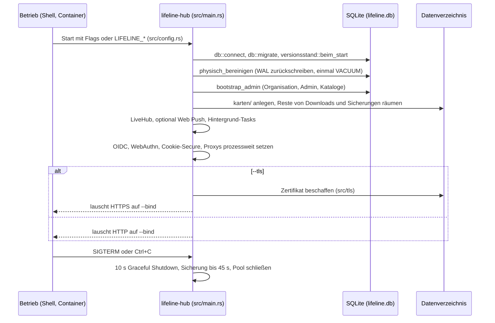
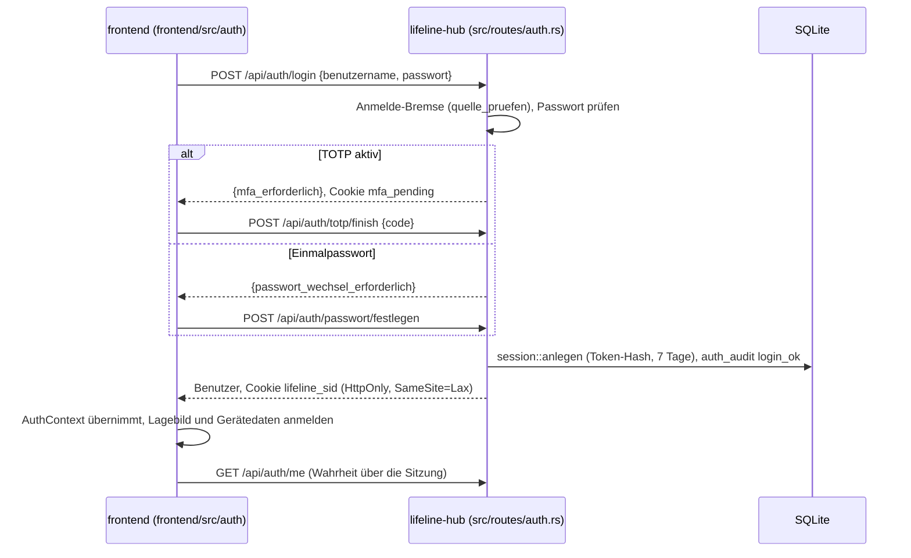
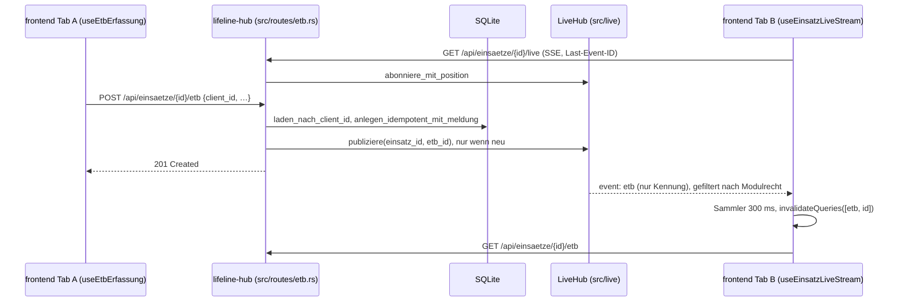
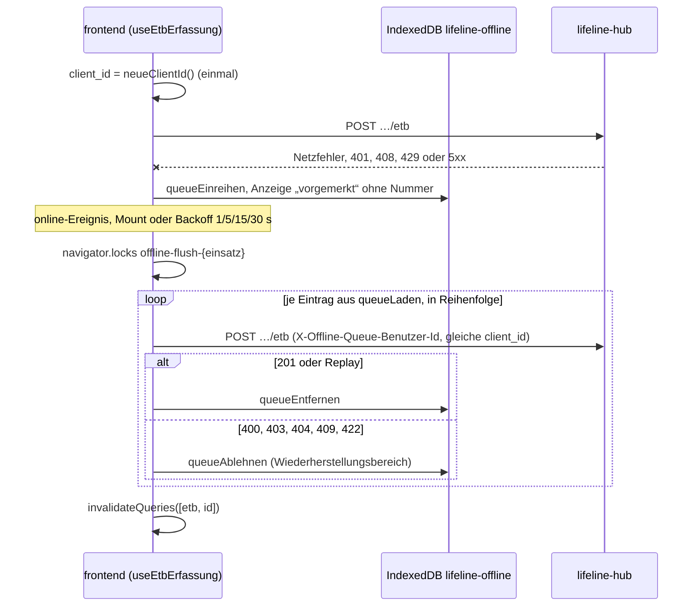
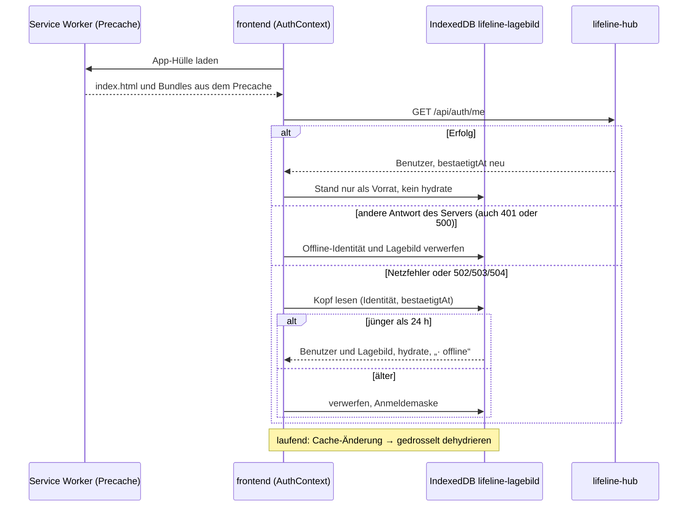
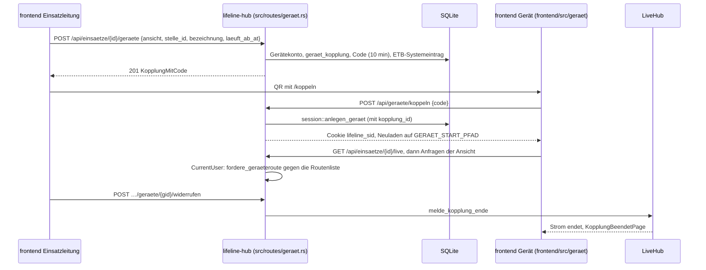
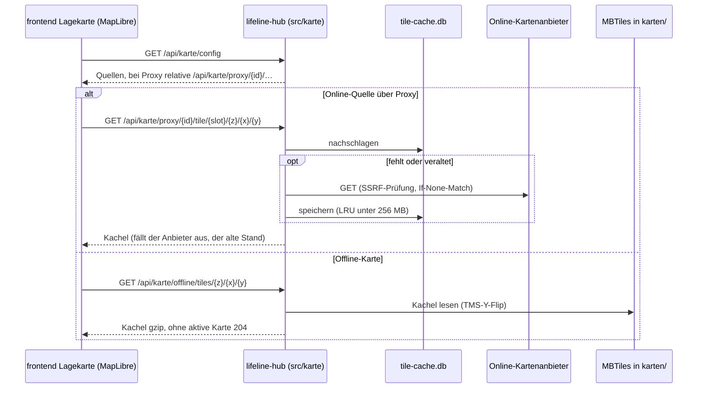
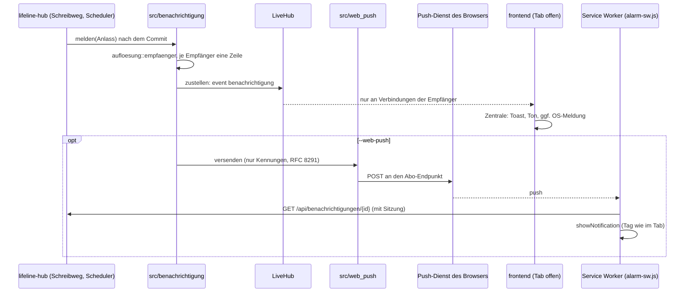

# 6. Laufzeitsicht

Stand: 23.10.2026 (alpha dcc500f5).

Dieses Kapitel zeigt acht Abläufe über mehrere Bausteine. Die Bausteine heißen wie in der
[Bausteinsicht](05-bausteinsicht.md). Die Diagramme zeigen den Regelfall; Sonderfälle und Regeln
stehen in den genannten Dateien und Bereichs-`AGENTS.md` und werden hier nicht wiederholt.

| Nr. | Szenario | Tragende Bausteine |
| --- | --- | --- |
| 6.1 | Start des Servers | `src/main.rs`, `src/config.rs`, `src/db.rs` |
| 6.2 | Anmeldung und Sitzung | `src/auth`, `frontend/src/auth`, `src-tauri` |
| 6.3 | ETB-Eintrag schreiben, Live-Ereignis verteilen | `src/etb`, `src/live`, `frontend/src/live` |
| 6.4 | Schreiben ohne Netz und Nachsenden | `frontend/src/offline`, `src/routes` |
| 6.5 | Lagebild ohne Netz lesen | `frontend/src/offline`, `frontend/src/auth`, Service Worker |
| 6.6 | Gerät koppeln und Funktionsansicht | `src/geraet`, `frontend/src/geraet` |
| 6.7 | Kartenkacheln über Proxy, Cache und Offline-Karte | `src/karte`, `karten-service` |
| 6.8 | Benachrichtigung und Web Push | `src/benachrichtigung`, `src/web_push`, `frontend/src/alarm` |

„Ohne Netz“ hat zwei Bedeutungen: In 6.4 und 6.5 erreicht das Endgerät den Server nicht. In 6.7
erreicht der Server das Internet nicht, die Endgeräte erreichen ihn aber.

## 6.1 Start des Servers

- Die Reihenfolge steht in `run_server` (`src/main.rs`). `bootstrap_admin` läuft vor den
  Dev-Seeds, weil es nur auf leerer Datenbank Kataloge anlegt; ohne `--admin-password` schreibt
  es ein erzeugtes Passwort ins Log.
- `db::connect` (`src/db.rs`): WAL, `busy_timeout` 5 s, `secure_delete`, höchstens 5
  Verbindungen. Neue Migrationen: Wurzel-[`AGENTS.md`](../../AGENTS.md), „Migrationsvergabe“.
- Hintergrund-Tasks aus `run_server`: Kanal-Sweep des `LiveHub` (alle 5 min,
  `src/live/mod.rs`), Erinnerungen (30 s, `src/erinnerung/scheduler.rs`), Purge und Schwärzung
  (600 s, `src/einsatz/purge_scheduler.rs`), Sicherung (nur mit `--backup-verzeichnis`,
  `src/backup`), Datenträgerprüfung (stündlich, `src/datentraeger/mod.rs`), KRITIS-Import
  (`src/karte/kritis`), Wächter der Offline-Karten (erste Prüfung nach 60 s,
  `src/karte/auto_aktualisierung.rs`).
- Schalter, die eine Vertrauensgrenze verschieben, landen als Warnung im Log; die Liste steht in
  [`docs/betrieb/env-registry.md`](../betrieb/env-registry.md). Beide Serve-Zweige laufen über
  `axum-server` mit `verbindung::SemaphorAkzeptor` und den Fristen aus `src/verbindung.rs`.
  Ohne Serverlauf arbeiten die Unterkommandos `backup`, `restore` und `sqlite-version`.

## 6.2 Anmeldung und Sitzung

- Passwortweg: `login` in `src/routes/auth.rs`. Bei Zweitfaktor entsteht noch keine Sitzung,
  nur ein Schlüssel in `src/auth/totp/state.rs` (5 min). Cookie: `session_cookie`; Lebensdauer
  `SITZUNG_TAGE` = 7 (`src/auth/session.rs`).
- **OIDC:** `oidc_start` leitet mit PKCE, `state` und `nonce` zum Identitätsanbieter;
  `oidc_callback` prüft das `state`-Cookie, legt die Sitzung an und leitet auf den Zielpfad. Der
  Service Worker beantwortet Seitenwechsel auf `/api/` deshalb nie mit der App-Hülle
  (`navigateFallbackDenylist`, `frontend/vite.config.ts`). **Passkey:** `src/auth/webauthn`, gelistet nur bei gültigem
  `rp_id`/`rp_origin` beim Start (`src/main.rs`).
- **Desktop-App (macOS):** „Im Browser anmelden“ öffnet eine `ASWebAuthenticationSession`
  (`src-tauri/src/aswas.rs`). Der Systembrowser holt mit seiner Sitzung über
  `POST /api/auth/app-code` einen Einmalcode (`TTL` 60 s, `src/auth/huelle/state.rs`) und springt
  mit `lifeline://anmeldung?code=…` zurück; die Hülle löst ihn mit dem PKCE-`verifier` im Webview
  über `POST /api/auth/app-code/einloesen` ein (`src-tauri/src/anmeldung.rs`). Regeln:
  [`src-tauri/AGENTS.md`](../../src-tauri/AGENTS.md).
- Jede schreibende Anfrage trägt `X-Erwarteter-Benutzer-Id`; bei Abweichung antwortet
  `CurrentUser` mit 412 und der Client prüft per `/me`. Regeln und Abmeldewege:
  [`frontend/src/auth/AGENTS.md`](../../frontend/src/auth/AGENTS.md).

## 6.3 ETB-Eintrag schreiben, Live-Ereignis verteilen

- `erfassen` (`src/routes/etb.rs`) prüft Schreibfreigabe, Offline-Queue-Besitzer und
  `client_id` vor dem Schreiben. Derselbe Eintrag unter derselben `client_id` ist ein Replay,
  anderer Wortlaut darunter 409 (`CLIENT_ID_KONFLIKT`).
- Über den Kanal geht nur die Kennung; der Client lädt mit seinen eigenen Rechten nach. Welches
  Ereignis welchem Modul gehört, legt `LiveEvent::modul_keys` fest (`src/live/mod.rs`).
- Puffer `KANAL_KAPAZITAET` und `REPLAY_KAPAZITAET` je 256, `REPLAY_KARENZ` 10 min
  (`src/live/mod.rs`). Nach einem Abriss liefert `Last-Event-ID` das Verpasste nach; nach einem
  Überlauf kommt `lagged`, und der Client gleicht alle Keys ab. Je Benutzer höchstens 16 Ströme,
  Lebensdauer 30 min plus Streuung (`src/live/strom.rs`).
- Der Client hält **eine** `EventSource` je Einsatz (`frontend/src/live/useEinsatzLiveStream.ts`)
  und verteilt über `EINSATZ_STREAM_EVENTS` (`frontend/src/api/queryKeys.ts`).
  `liveInvalidierung.ts` bündelt in Fenstern von 300 ms (Modulzähler 1000 ms). Scheitert die
  Verbindung, prüft `liveVerbindung.ts` `/api/auth/me` und übergibt bei 401 an die
  Sitzungswache. Spec: [`openspec/specs/live-abgleich/`](../../openspec/specs/live-abgleich/spec.md).

## 6.4 Schreiben ohne Netz und Nachsenden

- Ablauf und Fehlerklassen: `frontend/src/offline/useEtbErfassung.ts`. Person, Meldung, Stand,
  Belegung, Eintreffen und Verpflegung gehen über die `erfasse…OfflineFaehig`-Funktionen
  (`frontend/src/offline/schreiben.ts`) und den Abgleich in `useOfflineSync.ts`.
- Die `client_id` steht vor dem ersten Versuch fest: ein Commit mit verlorener Antwort wird beim
  Nachsenden zum Replay (6.3). Den Header `X-Offline-Queue-Benutzer-Id` prüft
  `fordere_offline_queue_benutzer` (`src/routes/support.rs`) gegen die Sitzung, Abweichung 412.
- Änderungen bestehender Daten (PATCH) sind ohne Netz gesperrt statt vorgemerkt; online schützt
  sie ein optimistisches Lock, etwa `basis_geaendert_at` an der Person
  (`src/routes/einsatz_person.rs`). Zeitstempel vorgemerkter Erfassungen folgen der Serveruhr
  (`frontend/src/offline/serveruhr.ts`).
- Regeln: [`frontend/src/offline/AGENTS.md`](../../frontend/src/offline/AGENTS.md), „Schreiben
  ohne Netz“ und „Gerätedaten beim Abmelden“.

## 6.5 Lagebild ohne Netz lesen

- Den Precache baut `VitePWA` mit `registerType: 'prompt'` (`frontend/vite.config.ts`); ein neuer
  Stand wird erst nach einem Klick aktiv (`frontend/src/pwa/appAktualisierung.ts`). Der Service
  Worker braucht einen sicheren Kontext, also HTTPS ([Verteilungssicht](07-verteilungssicht.md)).
- Die Startentscheidung trifft `startEntscheidung` mit `HOECHSTLIEGEZEIT_MS` = 24 h
  (`frontend/src/offline/lagebildStart.ts`), aufgerufen aus `AuthContext.tsx` über
  `lagebildStarten` (`frontend/src/offline/lagebildSitzung.ts`).
- Was auf die Platte darf, bestimmen `LAGEBILD_OFFLINE` und `istLagebildOfflineKey`
  (`frontend/src/api/queryKeys.ts`), gekürzt in `frontend/src/offline/lagebildKuerzung.ts`.
  Kartenkacheln liegen nicht im Browser; die Lagekarte holt sie vom Server (6.7).
- Regeln, Fristen, Räumen: [`frontend/src/offline/AGENTS.md`](../../frontend/src/offline/AGENTS.md).
  Spec: [`openspec/specs/lagebild-offline-lesen/`](../../openspec/specs/lagebild-offline-lesen/spec.md).

## 6.6 Gerät koppeln und Funktionsansicht

- Konstanten in `src/geraet/mod.rs`: `CODE_MINUTEN` = 10, `STANDARD_STUNDEN` = 24,
  `HOECHSTENS_STUNDEN` = 72; der Code hat 8 Zeichen aus 32 (`src/geraet/code.rs`).
- Die Schranke steht beim Server: `CurrentUser` (`src/auth/session.rs`) prüft für eine
  Gerätesitzung Methode und Routenmuster gegen die Liste der Funktionsansicht in
  `src/geraet/mod.rs`, was fehlt, ist 403. Stellenbindung: `src/geraet/stelle.rs`.
- Ein unbekannter, abgelaufener oder verbrauchter Code ist einheitlich 401 (eine gesperrte Adresse
  vorher 429); beide Ausgänge stehen in `auth_audit` mit dem Anbieter `geraetecode`
  (`src/routes/geraet.rs`). Regeln:
  [`frontend/src/geraet/AGENTS.md`](../../frontend/src/geraet/AGENTS.md).

## 6.7 Kartenkacheln über Proxy, Cache und Offline-Karte

- Proxy `src/karte/proxy.rs`: ein Schlüssel in der URL des Anbieters bleibt auf dem Server.
  Cache `src/karte/tile_cache.rs`: `TILE_CACHE_CAP_BYTES` = 256 MB in `<karten_dir>/tile-cache.db`;
  gleichzeitige Fehlgriffe auf dieselbe URL teilen sich einen Abruf (LFH-930, Modulkopf).
- Offline-Karten `src/karte/mbtiles.rs`; Glyphs und Sprite sind eingebettet
  (`/api/karte/offline/{fonts,sprites}/…`). Das Frontend wählt online, dann offline, sonst den
  Blind-Modus ([`docs/betrieb/packaging.md`](../betrieb/packaging.md), „Lagekarte / Basemap“).
- Bezug: Der Admin lädt eine Karte aus dem Katalog (`src/karte/katalog.rs`,
  `crates/karten-katalog`) per SHA256-Pin nach `karten/` (`src/karte/download.rs`).
  `POST /api/karte/offline-karten/bauen` reicht einen Bauauftrag mit Token an
  `POST {url}/builds` des `karten-service` weiter (`src/routes/karte.rs`). Der baut mit `make`
  und Docker aus `karten-build` (`karten-service/src/build/make_runner.rs`) und lädt Ergebnis und
  Manifest in den Objektspeicher (`karten-service/src/storage/s3.rs`). Spec:
  [`openspec/specs/offline-karten-aktualisierung/`](../../openspec/specs/offline-karten-aktualisierung/spec.md).

## 6.8 Benachrichtigung und Web Push

- Wer eine Benachrichtigung bekommt, entscheidet allein `melden` (`src/benachrichtigung/mod.rs`);
  den Text bildet der Server erst beim Lesen (`src/benachrichtigung/text.rs`).
- `frontend/src/live/benachrichtigungListener.ts` leitet nur weiter; Ton, Toast und Meldung
  entscheidet `frontend/src/alarm/useBenachrichtigungen.ts`. In der Desktop-App zeigt
  `benachrichtigung_zeigen` die Meldung über das Betriebssystem (`src-tauri/AGENTS.md`).
- Web Push nur mit `--web-push` (`src/main.rs`): höchstens 8 Versände gleichzeitig, 10 s
  Zeitlimit, der Push-Dienst hält die Nachricht 12 h, Abos nur bei Hosts in `PUSH_DIENSTE`
  (`src/web_push/mod.rs`). Erreicht der Service Worker den Server nicht, zeigt er den Titel der
  Stufe (`frontend/public/alarm-sw.js`).
- Specs: [`benachrichtigungen`](../../openspec/specs/benachrichtigungen/spec.md),
  [`web-push`](../../openspec/specs/web-push/spec.md); Betrieb:
  [`docs/betrieb/web-push.md`](../betrieb/web-push.md).
