# 6. Laufzeitsicht

Stand: 25.11.2026 (Ortung über den Hub im Spiegelabgleich, LLH-2119; Versand an Menschen, LLH-2093; Fahrzeugortung über den Positionsbaustein, LLH-2091; Fremdebene aus URL beim Lesen nachholen, LLH-2099; Live-Ereignis der Helfer-App nur für die Einsatzleitung, ADR-0101; Sperre des Push-Relais am ELW, LLH-2074; iOS-Push über das Push-Relais, LLH-1981; Neu vergebene IDs am Spiegel, LLH-1893; Abruf eines Adapters, LLH-2017).

Dieses Kapitel zeigt zehn Abläufe über mehrere Bausteine. Die Bausteine heißen wie in der
[Bausteinsicht](05-bausteinsicht.md). Die Diagramme zeigen den Regelfall; Sonderfälle und Regeln
stehen in den genannten Dateien und Bereichs-`AGENTS.md` und werden hier nicht wiederholt.

| Nr. | Szenario | Tragende Bausteine |
| --- | --- | --- |
| 6.1 | Start des Servers | `src/main.rs`, `src/config.rs`, `src/db.rs` |
| 6.2 | Anmeldung und Sitzung | `src/auth`, `frontend/src/auth`, `src-tauri` |
| 6.3 | ETB-Eintrag schreiben, Live-Ereignis verteilen | `src/etb`, `src/live`, `frontend/src/live` |
| 6.4 | Schreiben ohne Netz und Nachsenden | `frontend/src/offline`, `src/routes` |
| 6.5 | Lagebild ohne Netz lesen | `frontend/src/offline`, `frontend/src/auth`, Service Worker |
| 6.6 | Gerät koppeln und Funktionsansicht | `src/geraet`, `frontend/src/geraet` |
| 6.6a | Instanzen koppeln und melden | `src/instanz`, `src/routes` |
| 6.6b | Einsatz spiegeln und am Spiegel beantragen | `src/instanz` (`spiegel`), `src/auth`, `src/live` |
| 6.6h | Fremdebene aus URL beim Lesen nachholen | `src/karte_fremdebene`, `src/adapter` (`ziel.rs`), `frontend/src/pages/lagekarte` |
| 6.7 | Kartenkacheln über Proxy, Cache und Offline-Karte | `src/karte`, `karten-service` |
| 6.8 | Benachrichtigung, Web Push und iOS-Push | `src/benachrichtigung`, `src/web_push`, `src/ios_push`, `push-relais`, `ios`, `frontend/src/alarm` |

„Ohne Netz“ hat zwei Bedeutungen: In 6.4 und 6.5 erreicht das Endgerät den Server nicht. In 6.7
erreicht der Server das Internet nicht, die Endgeräte erreichen ihn aber.

## 6.1 Start des Servers

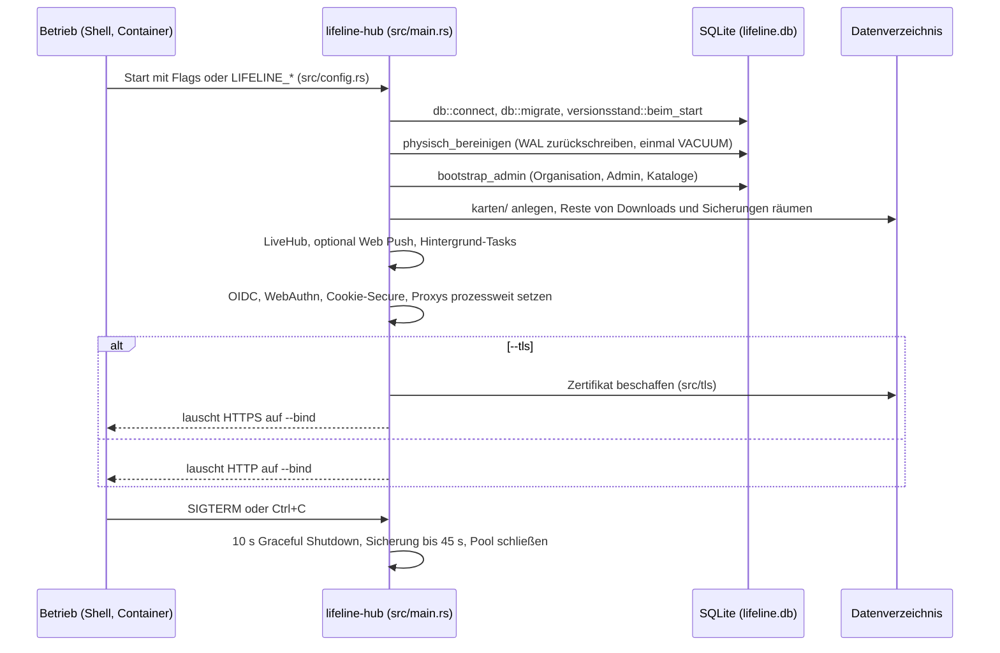

- Die Reihenfolge steht in `run_server` (`src/main.rs`). `bootstrap_admin` läuft vor den
  Dev-Seeds, weil es nur auf leerer Datenbank Kataloge anlegt; ohne `--admin-password` schreibt
  es ein erzeugtes Passwort ins Log.
- `db::connect` (`src/db.rs`): WAL, `busy_timeout` 5 s, `secure_delete`, höchstens 5
  Verbindungen. Neue Migrationen: [`migrations/AGENTS.md`](../../migrations/AGENTS.md), „Migrationsvergabe“.
- Hintergrund-Tasks aus `run_server`: Kanal-Sweep des `LiveHub` (alle 5 min,
  `src/live/mod.rs`), Erinnerungen (30 s, `src/erinnerung/scheduler.rs`), Purge und Schwärzung
  (600 s, `src/einsatz/purge_scheduler.rs`), Sicherung (nur mit `--backup-verzeichnis`,
  `src/backup`), Datenträgerprüfung (stündlich, `src/datentraeger/mod.rs`), KRITIS-Import
  (`src/karte/kritis`), Wächter der Offline-Karten (erste Prüfung nach 60 s,
  `src/karte/auto_aktualisierung.rs`), Zustellung der Webhooks (2 s,
  `src/public_api/webhook/lauf.rs`) und Abrufe der Adapter (5 s, `src/adapter/lauf.rs`; beide
  wartet das Herunterfahren begrenzt ab).
- Schalter, die eine Vertrauensgrenze verschieben, landen als Warnung im Log; die Liste steht in
  [`docs/betrieb/env-registry.md`](../betrieb/env-registry.md). Beide Serve-Zweige laufen über
  `axum-server` mit `verbindung::SemaphorAkzeptor` und den Fristen aus `src/verbindung.rs`.
  Ohne Serverlauf arbeiten die Unterkommandos `backup`, `restore` und `sqlite-version`.

## 6.2 Anmeldung und Sitzung

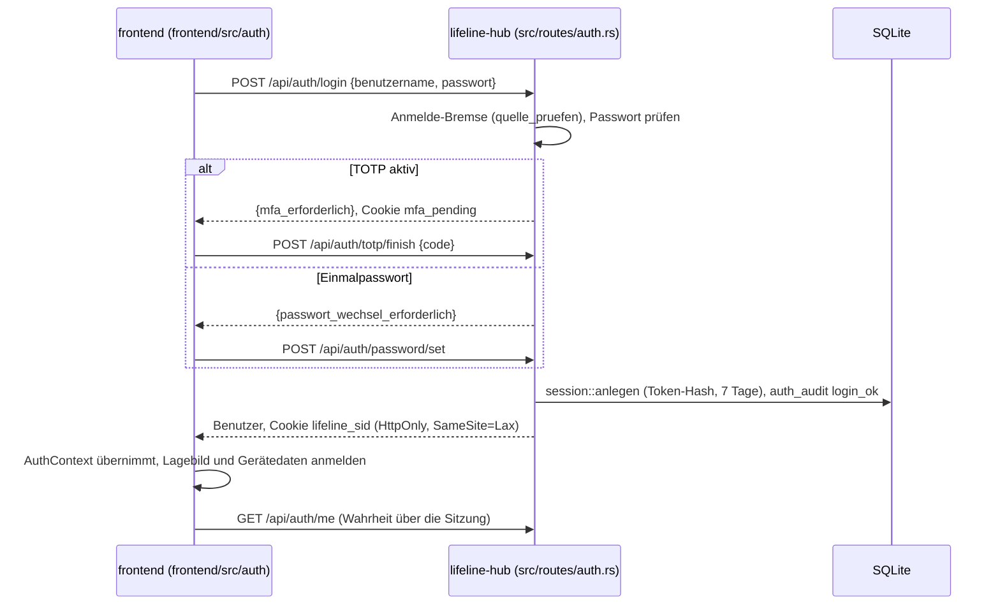

- Passwortweg: `login` in `src/routes/auth.rs`. Bei Zweitfaktor entsteht noch keine Sitzung,
  nur ein Schlüssel in `src/auth/totp/state.rs` (5 min). Cookie: `session_cookie`; Lebensdauer
  `SITZUNG_TAGE` = 7 (`src/auth/session.rs`).
- **OIDC:** `oidc_start` leitet mit PKCE, `state` und `nonce` zum Identitätsanbieter;
  `oidc_callback` prüft das `state`-Cookie, legt die Sitzung an und leitet auf den Zielpfad. Der
  Service Worker beantwortet Seitenwechsel auf `/api/` deshalb nie mit der App-Hülle
  (`navigateFallbackDenylist`, `frontend/vite.config.ts`). **Passkey:** `src/auth/webauthn`, gelistet nur bei gültigem
  `rp_id`/`rp_origin` beim Start (`src/main.rs`).
- **Desktop-App (macOS):** „Im Browser anmelden“ öffnet eine `ASWebAuthenticationSession`
  (`src-tauri/src/aswas.rs`). Der Systembrowser holt mit seiner Sitzung über
  `POST /api/auth/app-code` einen Einmalcode (`TTL` 60 s, `src/auth/huelle/state.rs`) und springt
  mit `lifeline://anmeldung?code=…` zurück; die Hülle löst ihn mit dem PKCE-`verifier` im Webview
  über `POST /api/auth/app-code/redeem` ein (`src-tauri/src/anmeldung.rs`). Regeln:
  [`src-tauri/AGENTS.md`](../../src-tauri/AGENTS.md).
- Jede schreibende Anfrage trägt `X-Erwarteter-Benutzer-Id`; bei Abweichung antwortet
  `CurrentUser` mit 412 und der Client prüft per `/me`. Regeln und Abmeldewege:
  [`frontend/src/auth/AGENTS.md`](../../frontend/src/auth/AGENTS.md).

## 6.3 ETB-Eintrag schreiben, Live-Ereignis verteilen

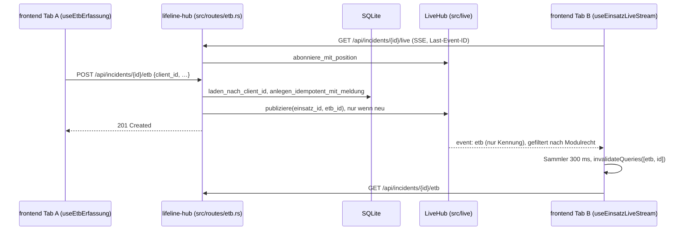

- `erfassen` (`src/routes/etb.rs`) prüft Schreibfreigabe, Offline-Queue-Besitzer und
  `client_id` vor dem Schreiben. Derselbe Eintrag unter derselben `client_id` ist ein Replay,
  anderer Wortlaut darunter 409 (`CLIENT_ID_KONFLIKT`).
- Über den Kanal geht nur die Kennung; der Client lädt mit seinen eigenen Rechten nach. Welches
  Ereignis welchem Modul gehört, legt `LiveEvent::modul_keys` fest (`src/live/mod.rs`).
  Ergänzung zu ADR-0003 (Helfer-App, ADR-0101): `LiveEvent::Helfer` trägt kein Modul, sondern
  ist über `LiveEvent::nur_leitung` an die Einsatzleitung gebunden. Ohne dieses Kennzeichen der
  Verbindung erreicht es niemanden (fail-closed, `LiveNachricht::fuer_verbindung`,
  `src/live/mod.rs`); die Variante steht im Enum-Wire-Kontrakt wie jede andere.
- Puffer `KANAL_KAPAZITAET` und `REPLAY_KAPAZITAET` je 256, `REPLAY_KARENZ` 10 min
  (`src/live/mod.rs`). Nach einem Abriss liefert `Last-Event-ID` das Verpasste nach; nach einem
  Überlauf kommt `lagged`, und der Client gleicht alle Keys ab. Je Benutzer höchstens 16 Ströme,
  Lebensdauer 30 min plus Streuung (`src/live/strom.rs`). Beide Ströme senden alle 15 s das
  Kontroll-Ereignis `heartbeat` ohne `id:` (`strom::mit_heartbeat`, LLH-1935).
- Der Client hält **eine** `EventSource` je Einsatz (`frontend/src/live/useEinsatzLiveStream.ts`)
  und verteilt über `EINSATZ_STREAM_EVENTS` (`frontend/src/api/queryKeys.ts`).
  `liveInvalidierung.ts` bündelt in Fenstern von 300 ms (Modulzähler 1000 ms). Scheitert die
  Verbindung, prüft `liveVerbindung.ts` `/api/auth/me` und übergibt bei 401 an die
  Sitzungswache. Bleibt eine offene Verbindung 45 s ohne Ereignis (halboffenes TCP im Funkloch),
  meldet `liveVerbindung.ts` den Wiederaufbau und baut selbst neu auf, mit Vollabgleich. Spec: [`openspec/specs/live-abgleich/`](../../openspec/specs/live-abgleich/spec.md).

### 6.3a Präsenz an einer Angabe

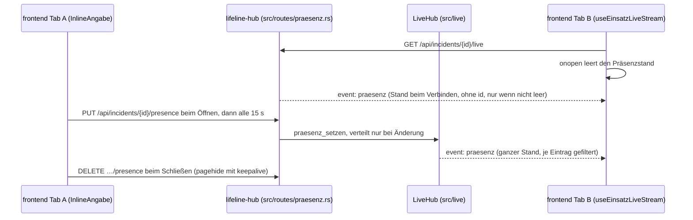

- Der Stand lebt nur im Speicher (`src/live/praesenz.rs`, Ablauf 45 s, Aufräumtakt 5 s) und geht
  am Replay-Ring vorbei als eigener Teilstrom in den Einsatzstrom (`src/routes/live.rs`,
  `routes::support::sse_praesenz_stream`). Entscheidung: ADR-0074.
- Der Client hält ihn in `frontend/src/live/praesenz.ts`; `InlineAngabe` zeigt „Wird gerade
  bearbeitet von …“ an Stelle der Vermerkzeile. Herleitung:
  `docs/superpowers/specs/2026-11-19-errkrb6m-praesenzanzeige-design.md`.

## 6.4 Schreiben ohne Netz und Nachsenden

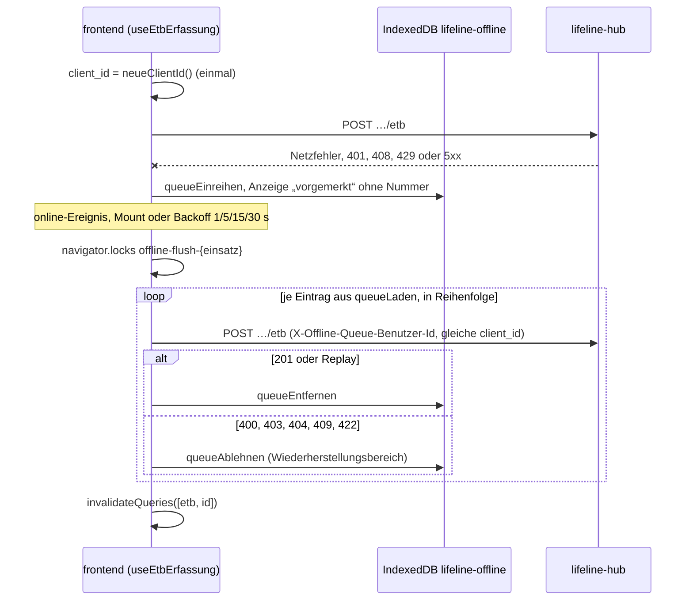

- Ablauf und Fehlerklassen: `frontend/src/offline/useEtbErfassung.ts`. Person, Meldung, Stand,
  Belegung, Eintreffen und Verpflegung gehen über die `erfasse…OfflineFaehig`-Funktionen
  (`frontend/src/offline/schreiben.ts`) und den Abgleich in `useOfflineSync.ts`.
- Die `client_id` steht vor dem ersten Versuch fest: ein Commit mit verlorener Antwort wird beim
  Nachsenden zum Replay (6.3). Den Header `X-Offline-Queue-Benutzer-Id` prüft
  `fordere_offline_queue_benutzer` (`src/routes/support.rs`) gegen die Sitzung, Abweichung 412.
- Änderungen bestehender Daten (PATCH) sind ohne Netz gesperrt statt vorgemerkt; online schützt
  sie ein optimistisches Lock, etwa `basis_geaendert_at` an der Person
  (`src/routes/einsatz_person.rs`). Zeitstempel vorgemerkter Erfassungen folgen der Serveruhr
  (`frontend/src/offline/serveruhr.ts`).
- Regeln: [`frontend/src/offline/AGENTS.md`](../../frontend/src/offline/AGENTS.md), „Schreiben
  ohne Netz“ und „Gerätedaten beim Abmelden“.

## 6.5 Lagebild ohne Netz lesen

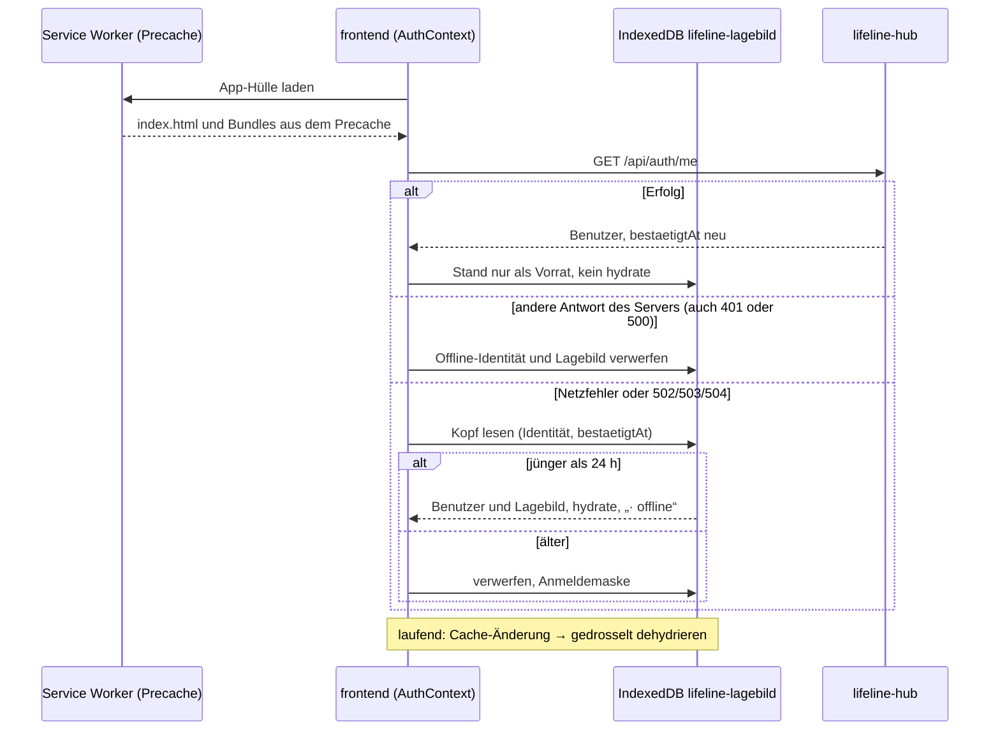

- Den Precache baut `VitePWA` mit `registerType: 'prompt'` (`frontend/vite.config.ts`); ein neuer
  Stand wird erst nach einem Klick aktiv (`frontend/src/pwa/appAktualisierung.ts`). Der Service
  Worker braucht einen sicheren Kontext, also HTTPS ([Verteilungssicht](07-verteilungssicht.md)).
- Die Startentscheidung trifft `startEntscheidung` mit `HOECHSTLIEGEZEIT_MS` = 24 h
  (`frontend/src/offline/lagebildStart.ts`), aufgerufen aus `AuthContext.tsx` über
  `lagebildStarten` (`frontend/src/offline/lagebildSitzung.ts`).
- Was auf die Platte darf, bestimmen `LAGEBILD_OFFLINE` und `istLagebildOfflineKey`
  (`frontend/src/api/queryKeys.ts`), gekürzt in `frontend/src/offline/lagebildKuerzung.ts`.
  Kartenkacheln liegen nicht im Browser; die Lagekarte holt sie vom Server (6.7).
- Regeln, Fristen, Räumen: [`frontend/src/offline/AGENTS.md`](../../frontend/src/offline/AGENTS.md).
  Spec: [`openspec/specs/lagebild-offline-lesen/`](../../openspec/specs/lagebild-offline-lesen/spec.md).
- **iOS-App** (LLH-1980, [ADR-0082](entscheidungen/ADR-0082-die-ios-huelle-startet-ohne-server-aus-gespeicherter-index-html-und-dem-http-cache.md)):
  Im WKWebView läuft kein Service Worker. Die Hülle wärmt nach jedem Laden vom Server die Liste
  `assets` aus `GET /api/shell` im Webview vor (`ios/App/Huelle/vorwaermen.js`) und legt danach
  die `index.html` je Server ab (`ios/LifelineKern/Sources/LifelineKern/Vorratsablage.swift`).
  Antwortet der Server beim Start nicht, lädt sie diese per `loadSimulatedRequest` unter der
  Adresse des Servers; ab da läuft der Ablauf oben unverändert. Kommt der Server mit derselben
  Version zurück, bleibt die Seite stehen, mit einer anderen lädt die Hülle neu
  (`ios/LifelineKern/Sources/LifelineKern/Ablauf.swift`).

## 6.6 Gerät koppeln und Funktionsansicht

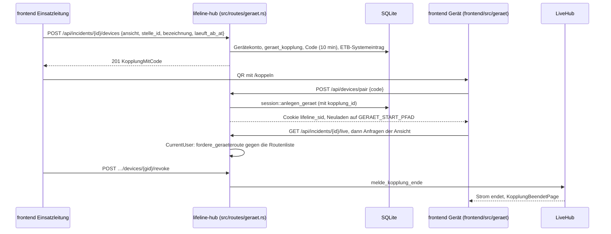

- Konstanten in `src/geraet/mod.rs`: `CODE_MINUTEN` = 10, `STANDARD_STUNDEN` = 24,
  `HOECHSTENS_STUNDEN` = 72; der Code hat 8 Zeichen aus 32 (`src/geraet/code.rs`).
- Die Schranke steht beim Server: `CurrentUser` (`src/auth/session.rs`) prüft für eine
  Gerätesitzung Methode und Routenmuster gegen die Liste der Funktionsansicht in
  `src/geraet/mod.rs`, was fehlt, ist 403. Stellenbindung: `src/geraet/stelle.rs`.
- Ein unbekannter, abgelaufener oder verbrauchter Code ist einheitlich 401 (eine gesperrte Adresse
  vorher 429); beide Ausgänge stehen in `auth_audit` mit dem Anbieter `geraetecode`
  (`src/routes/geraet.rs`). Regeln:
  [`frontend/src/geraet/AGENTS.md`](../../frontend/src/geraet/AGENTS.md).

## 6.6a Instanzen koppeln und melden

Zwei Instanzen (etwa ELW und Hub) koppeln sich per Einmal-Code (LLH-1490,
[ADR-0034](entscheidungen/ADR-0034-maschinen-weisen-sich-mit-schluesselpaar-aus-ausser-beim-einwurf.md)).
A stellt aus und wird gemeldet, E löst ein und meldet sich; das Protokoll kennt nur diese
Richtung, nicht Hub und ELW.

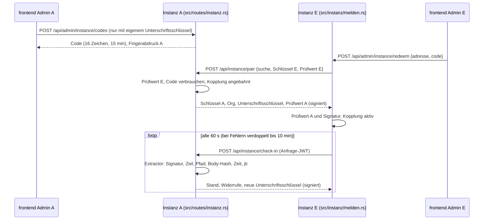

- Der Code geht nie über die Leitung: HKDF leitet `suche` und die Schlüssel beider Prüfwerte ab
  (`src/instanz/code.rs`). Ein Angreifer in der Mitte, der einen Schlüssel tauscht, fällt am
  Prüfwert auf (`tests/instanz_kopplung.rs`, `angreifer_in_der_mitte_faellt_auf`).
- Eine angebahnte Kopplung ohne erste Meldung verfällt nach 15 Minuten; einen Widerruf der
  meldenden Seite trägt eine letzte Meldung, den der erreichten Seite die Antwort auf die nächste.
- Neue Unterschriftsschlüssel nimmt E nur mit Gegenzeichnung eines bekannten an
  (`src/auth/unterschrift/repo.rs`, `accept_lieferungen`).

**Direktkopplung vor Ort** (LLH-1497,
[ADR-0029](entscheidungen/ADR-0029-eine-direktkopplung-beglaubigt-das-tls-zertifikat-per-signierter-aussage.md)):
zwei ELW im selben LAN, A mit selbstsigniertem Zertifikat.

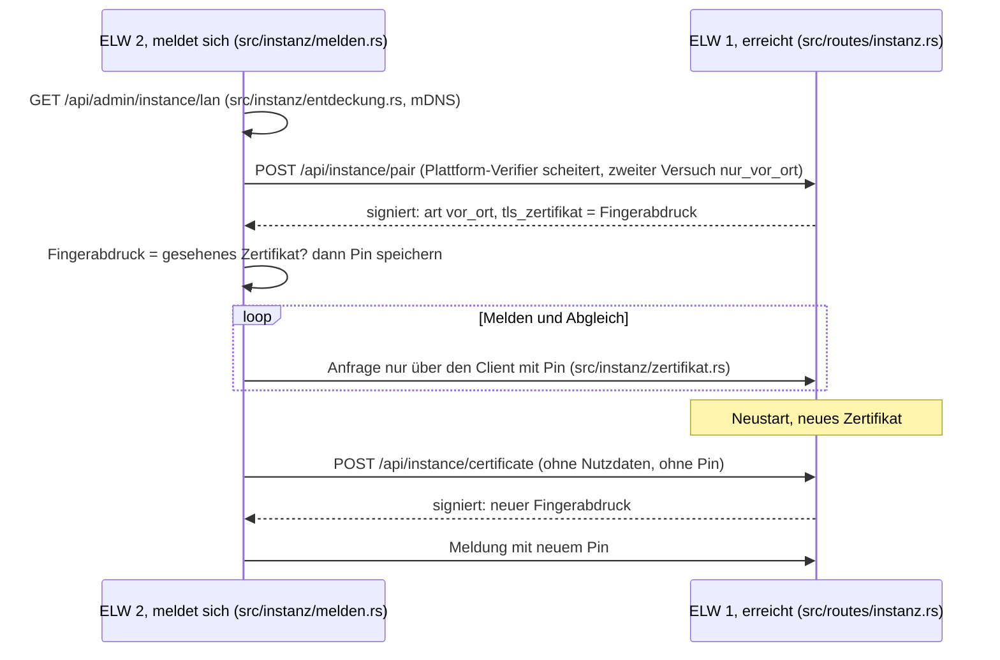

- Abweisungen an eine Gegenstelle mit gültigem Code gehen klar hinaus und verbrauchen den Code
  nicht: 426 bei Protokoll unter 3, 409 bei anderer Art (`src/routes/instanz.rs`, `check_art`).
- Findet ELW 2 die Gegenstelle nicht, sucht es sie per Kennung im LAN; eine neue Adresse gilt
  erst nach der signierten Aussage zum Zertifikat (`src/instanz/melden.rs`, `neu_aufloesen`).
- Über die Direktkopplung fließen nur Akten zur Anzeige, Spiegel und Anträge;
  `InstanzKopplungArt::traegt` sperrt Stammdaten, Geheimnisse, Verwahrung und Führungswechsel
  (`src/instanz/mod.rs`). Konten und Stammdaten bildet die Ursprungskennung ab. Nachweis:
  `tests/instanz_vor_ort.rs`.

## 6.6b Einsatz spiegeln und am Spiegel beantragen

Eine gekoppelte Instanz hält die Einsätze der zugeordneten Orgs, die sie nicht führt, als
Spiegel (LLH-1492,
[ADR-0018](entscheidungen/ADR-0018-ein-einsatz-wird-als-spiegel-in-denselben-tabellen-gehalten.md)).
Das Diagramm zeigt den Fall „ELW führt, meldet sich beim Hub; am Hub entsteht ein Antrag“. Führt
die erreichte Seite, kehrt sich nur um, wer liefert: Die meldende Seite nennt ihre `staende`, die
Lieferung kommt in der Antwort, und die erreichte Seite führt Anträge vor ihrer Antwort aus.

```mermaid
sequenceDiagram
  participant SB as frontend am Hub (Spiegel)
  participant H as Hub, erreicht (src/instanz/spiegel/abgleich.rs)
  participant E as ELW, meldet sich und führt (src/instanz/spiegel/takt.rs)
  participant ER as ELW, eigener Router (src/app.rs)
  SB->>H: POST /api/incidents/{id}/etb
  H->>H: antrag::schicht: Spiegel, BEANTRAGBAR, Verweise lokal → fremd
  H-->>SB: 202 {antrag: ausstehend}
  loop Tick 1 s; je Kopplung 5 s bei Aktivität, sonst Takt der Meldung
    E->>H: POST /api/instance/mirror {quittungen, antraege, staende, lieferungen ab spiegel_ziel, abrufe, anhang_teile}
    H->>H: Lieferung übernehmen (Merker, spiegel_herkunft, Stand nur vorwärts)
    H-->>E: {antraege (jetzt zugestellt), staende, abrufe, …} signiert
    E->>E: spiegel_ziel = staende der Antwort
    E->>ER: oneshot(POST …/etb) mit AntragAkteur
    ER-->>E: 201 {id}, Quittung in spiegel_antrag_eingang
  end
  Note over H,E: nächste Runde: Quittung „übernommen“ und der neue Eintrag gehen zum Hub
  H-->>SB: Live `lagged` je Einsatz, die Abfragen laden neu
```

- **Stand:** Trigger an jeder gespiegelten Tabelle schreiben `einsatz_aenderung` (Tabelle,
  Schlüssel, global steigender `stand`, je Zeile höchstens einmal); geliefert werden die Zeilen
  über dem Stand der spiegelnden Seite mit ihrem aktuellen Inhalt (`src/instanz/spiegel/liefern.rs`).
  Einen niedrigeren Stand, etwa nach einer Wiederherstellung, beliefert der Führer neu ab dort.
- **Paket:** Anfrage und Antwort sind dasselbe `SpiegelPaket`, je höchstens `SPIEGEL_MAX` = 2 MiB;
  Lieferungen füllen das Budget bis auf `RESERVE`, Anträge und Quittungen stehen vorn
  (`src/instanz/spiegel/paket.rs`). Übernommen wird je Einsatz in einer Transaktion unter dem
  Merker `spiegel_uebernahme` (`src/instanz/spiegel/uebernehmen.rs`).
- **Takt:** `--instanz-spiegel-sekunden` (Vorgabe 5, 2 bis 600, `src/config.rs`) gilt, solange
  ein Einsatz der Kopplung aktiv ist, Anträge offen oder Anhänge angefordert sind; sonst der Takt
  der Meldung. Fehler verdoppeln den Abstand bis 600 s; ein neuer Antrag oder eine Anforderung
  weckt den Lauf (`takt::wecken`). Nur die meldende Seite läuft; ein Gegenüber unter
  `PROTOKOLL_SPIEGEL` wird nicht abgeglichen (`abgleich::kann_spiegeln`).
- **Anhänge:** Inhalte reisen zuerst nur mit Größe und Prüfsumme. Ein Abruf am Spiegel antwortet
  409 „Der Anhang wird von der führenden Instanz geholt.“, fordert an und weckt. Die Stücke à
  256 KiB kommen mit der nächsten Nachricht des Führers (liefert die meldende Seite, in weiteren
  Runden desselben Abgleichs, `abgleich::RUNDEN_MAX`), angeforderte vor vorab geladenen, und
  gelten erst nach passender Prüfsumme (`src/instanz/spiegel/anhang.rs`).
- **Antrag:** 2xx beim Führer ist „übernommen“, 4xx „abgelehnt“ mit dem Text der Antwort, 5xx
  kein Ergebnis (erneute Zustellung). Eine zweite Zustellung derselben Antrags-ID bekommt die
  gespeicherte Quittung (`src/instanz/spiegel/antrag.rs`, `ausfuehren`). Am Spiegel verschwindet
  ein übernommener Antrag erst, wenn `spiegel_herkunft` die entstandene Zeile kennt.
- **Widerruf** einer Org-Zuordnung setzt `einsatz_spiegel.beendet_at`, lehnt offene Anträge ab
  und löscht `spiegel_ziel`, in der Transaktion des Widerrufs (`instanz::spiegel::beende_fuer_zuordnung`).
  Nachweis: `tests/instanz_spiegel.rs`.
- **Lebensende** (LLH-1494): Nach der Nachbereitung schickt die meldende Seite einen eigenen
  Einsatz als `verwahrt` mit Stand und Kategorie-Fristen. Die erreichte Seite übernimmt zuerst die
  Lieferung derselben Anfrage und die Anhang-Stücke, dann wandelt sie ihren Spiegel bei gleichem
  Stand und ohne fehlenden Anhang in einen eigenen Einsatz und quittiert `angenommen`; sonst
  `wartet` mit Grund, fehlende Anhänge sind dann angefordert. Erst `angenommen` merkt den
  Einsatz der meldenden Seite zum Abräumen vor (`src/einsatz/abraeumen.rs`, nach dem Commit).
  `geloescht` meldet der Führer für genannte Kennungen nur mit Beleg, wie für Akten ohne Spiegel
  (unten): im Pull in der Antwort, im Push in der nächsten Anfrage, nachdem die erreichte Seite
  die Stände ihrer Spiegel genannt hat (`src/instanz/spiegel/lebensende.rs`, `abgleich.rs`). Der
  Spiegel endet nur, wenn er zu dieser Kopplung gehört und der Absender sein Führer ist: mit
  Führung je Einsatz laut Akte, auch wenn die Kennung mit einer anderen Instanz beginnt (der
  Führer hat den Einsatz übernommen), sonst nach dem Präfix (LLH-1852,
  [ADR-0042](entscheidungen/ADR-0042-ein-spiegel-endet-nur-auf-meldung-seines-fuehrers-laut-akte.md)).
  Nachweis: `tests/instanz_lebensende.rs`, `tests/instanz_fuehrung.rs`.
- **Ende einer Akte ohne Spiegel** (LLH-1699,
  [ADR-0036](entscheidungen/ADR-0036-das-ende-eines-einsatzes-meldet-eine-instanz-nur-mit-beleg.md)):
  Wer bei eingeschalteter Führung eine Führungsakte ohne lokalen Einsatz hält, nennt ihre Kennung
  im Abgleich (`SpiegelPaket.akten`), und zwar dem Gegenüber, das über sie entscheidet: dem
  Führer der Akte, die meldende Seite auch ihrem einzigen Hub, solange der Führer nicht selbst
  ihr Gegenüber ist (`fuehrung::repo::is_gegenueber_zustaendig`). Das Gegenüber meldet `geloescht` auf demselben Weg
  wie für Spiegel, aber nur mit Beleg: Löschvermerk (`src/instanz/fuehrung/loeschvermerk.rs`)
  oder, für ältere Löschungen, eigenes Präfix im Löschprotokoll. Der Vermerk entsteht, wo ein
  Einsatz endet (Skelett-Löschung, Verwahrung, `geloescht` des Führers an einem Spiegel). Der
  Empfänger löscht die Akte und vermerkt ihr Ende selbst; so erfährt es eine weitere ELW vom Hub
  mit ihrem nächsten Abgleich. Der Widerruf einer Org-Zuordnung löscht und vermerkt die Akten
  ohne Spiegel, die das widerrufene Gegenüber führt (`fuehrung::repo::release_nach_widerruf`).
  Nachweis: `tests/instanz_fuehrung.rs`.

## 6.6c Führung je Einsatz: Notübernahme gegen den ELW

Mit dem Schalter `LIFELINE_FUEHRUNG` tauschen gekoppelte Instanzen in jeder Meldung ihre
Führungsakten aus (LLH-1491,
[ADR-0044](entscheidungen/ADR-0044-ueber-eine-direktkopplung-gibt-keine-seite-ohne-beweis-und-einsatzleitung-ab.md)). Genau eine
Instanz führt einen Einsatz; die Epoche ist ein Paar (Zähler, Instanzkennung). Seit LLH-1641
entscheidet die Akte, wer führt, und der Spiegel folgt ihr: wer die Führung abgibt, wird Spiegel
mit Anträgen; wer sie bekommt, schreibt den bisherigen Spiegel weiter.

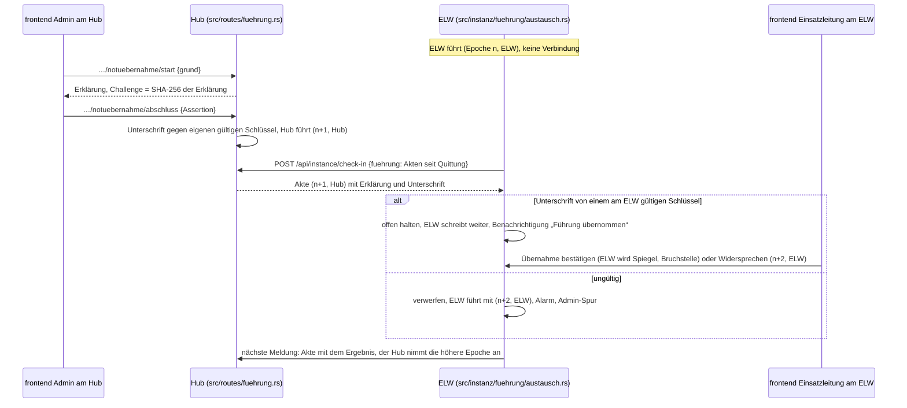

- Die erreichte Seite (Hub) nimmt eine höhere Epoche der meldenden ohne Beweis an; die meldende
  (ELW) nur mit Unterschrift oder Abgabecode und nach der Entscheidung eines Menschen
  (`austausch::entscheide`).
- Mehrere ELW an einem Hub: Der Hub behält die zuerst angenommene Führung. Nennt er einer ELW, die
  selbst führt, einen Dritten als Führer, hält sie dessen Führung offen und gibt erst nach
  Bestätigung ab (`austausch::ist_konflikt`, ohne Widerspruch); führt der Hub selbst mit der
  Epoche eines Dritten oder mit einer Erklärung gegen einen Dritten (er holte sich die Führung per
  Notübernahme oder Widerruf von einer anderen ELW zurück), hält sie das als gewöhnliche Übernahme
  offen, ohne Alarm, und ihren Widerspruch nimmt der Hub an ([ADR-0044](entscheidungen/ADR-0044-ueber-eine-direktkopplung-gibt-keine-seite-ohne-beweis-und-einsatzleitung-ab.md)).
- Gesperrt ist nur der Spiegel (`einsatz.spiegel`, Schutz-Trigger, 409 `einsatz_ist_spiegel`).
  `instanz::spiegel::fuehrung::richte_aus` richtet ihn bei jedem Speichern einer Akte aus
  (`werde_fuehrer`, `werde_spiegel`); die Bedienung zieht `EinsatzFuehrungszugriff`.
- Übergabe geht nur abgeglichen (`fordere_abgeglichen`, sonst 409 „Abgleich läuft noch“); eine
  Anfrage wartet am Führer (`anfrage_von`), bis der Anfragende alles hat. Eine Notübernahme geht
  nur an einem Einsatz, der hier als Spiegel vorliegt.
- Nach dem Wechsel liefert der neue Führer; der Kopf jeder Zeile trägt im Feld `gegen` den
  Schlüssel des Empfängers, damit Zeilen beider Seiten zusammenfinden. Was die abgelöste Seite
  nach der Bruchstelle schrieb, fragt sie beim Führer nach (`EinsatzStand.bruch`); was er nicht
  kennt, entfernt sie und sichert es in `einsatz_bruchstelle`. Hat der Führer den Einsatz nie von
  ihr gespiegelt (Widerspruch gegen eine Notübernahme), antwortet er `kennt: false`; dann entfernt
  sie alles, was nicht über `spiegel_herkunft` vom Führer stammt (`fuehrung::nicht_vom_fuehrer`,
  LLH-1854). Vergibt SQLite die ID einer gelöschten Zeile neu, räumt der Log-Trigger ihre
  Herkunft und merkt sich die Neuvergabe in `spiegel_neu_vergeben`: Die neue Zeile geht mit dem
  `gegen` der gelöschten hinaus, und nach einem Rückfall gilt sie als dem Führer unbekannt
  (`fuehrung::neu_vergeben`, [ADR-0081](entscheidungen/ADR-0081-eine-neu-vergebene-id-ist-am-spiegel-eine-neue-zeile.md),
  LLH-1893). Zeilen, die aufeinander zeigen,
  ordnet sie je Erfassung (`folge_von`); ETB-Einträge und Meldungen stellt sie auf Wunsch als
  Antrag mit der ursprünglichen `client_id` nach (`instanz::spiegel::bruchstelle`, LLH-1646), so
  kommen sie beim Führer genau einmal an. Eine Ablehnung öffnet die Erfassung wieder, eine
  Übernahme merkt sich den Schlüssel beim Führer (`nachgereicht_als`). Personen gehen samt Verlauf
  (LLH-1657): Folge einer Person ist nur, was über `person_id` an ihr hängt (`URSPRUNG`), dazu
  ihre Systemeinträge im ETB; die Person selbst, ihr Haushalt und ihre UHS-Aufnahme sind immer
  eigene Erfassungen. Gestellt wird die Person; ist sie beim Spiegel zurück
  (`spiegel_herkunft`), stellt `bruchstelle::ketten_fortsetzen` im Takt ihre Einträge in
  Zeitfolge mit dem Pfad auf die Person hier, danach einmal die Nachreich-Notiz (`notiz_at`). Ein
  abgelehnter oder nicht stellbarer Eintrag löst sich mit `grund` aus der Kette. Jede Schwärzung beim
  Führer (Kategorie, Löschersuchen je Person, ganzer Einsatz) löscht dort die Bruchstelle und setzt
  `einsatz.schwaerzung_marke` neu (Zufallswert); bringt der Kopf am Spiegel eine andere Marke,
  räumt auch er seine Bruchstelle (`fuehrung::raeume_bruchstelle`, LLH-1649): Alle Kopien und
  Geklärtes gehen; offene Zeilen fragt er ohne Kopie weiter (`geraeumt`) und löscht sie ganz,
  sobald sie geklärt sind. Neu ist nur eine Marke, die der Einsatz an dieser Instanz nie hatte
  (`einsatz_schwaerzung_marke`): Bringt der neue Führer nach einer Trennung die Marke von davor,
  räumt eine eigene Schwärzung dieser Seite nichts; hat er selbst geschwärzt, räumt sie.
- Offene Anträge der neuen führenden Seite führt sie selbst aus (`antrag::fuehre_eigene_aus`),
  genau einmal; Anhänge, die ihr fehlen, holt sie beim alten Führer.
- Akten gehen als Delta über einen Stand je Instanz, höchstens 50 je Nachricht
  (`tests/instanz_fuehrung.rs`).
- Über eine Direktkopplung zweier ELW (LLH-1678, `instanz::wechselregel` `gleichrangig`) laufen
  dieselben Schritte in beide Richtungen: Jede Seite prüft eine Übernahme gegen sich wie der ELW
  oben (`austausch::entscheide_vor_ort`), die übernehmende nimmt Widerspruch oder Verwerfen ihrer
  eigenen Übernahme mit Alarm an, und eine Anfrage erfüllt nur die Einsatzleitung der führenden
  Seite. Der Hub zieht den Wechsel nach, sobald der alte Führer sich meldet oder die Unterschrift
  der Notübernahme an ihm gilt (`tests/instanz_vor_ort.rs`).

## 6.6d Fremdsystem anbinden

Ein Fremdsystem meldet sich nach demselben Verfahren wie eine Instanz an, mit eigenem Profil und
eigenen Tabellen (LLH-1652,
[ADR-0096](entscheidungen/ADR-0096-fremdsysteme-sprechen-signiert-mit-der-oeffentlichen-api-v1-zusage-ab-1-0.md),
Spec [`maschinenzugang`](../../openspec/specs/maschinenzugang/spec.md)).

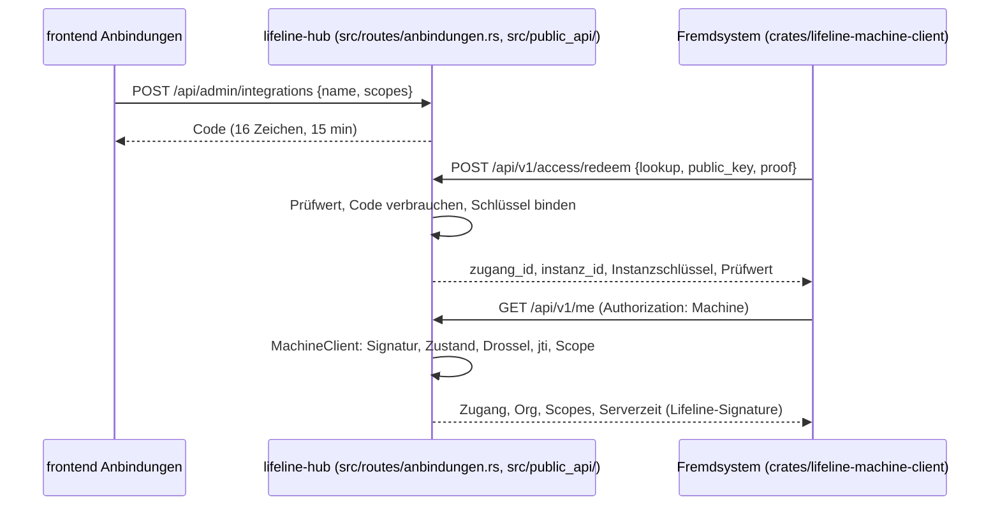

- Signatur und Code-Ableitung teilt `src/instanz/signatur.rs` bzw. `src/instanz/code.rs` mit der
  Instanzkopplung über ein Profil (`MACHINE`, `SALZ_MACHINE`); ein Token des einen Profils
  scheitert am anderen.
- Ein gescheiterter Abruf antwortet 401 ohne Grund; der Grund (etwa die Uhrabweichung) steht am
  Zugang (`src/public_api/zugang.rs`, `ablehnung_festhalten`) und auf der Seite „Anbindungen“.
- Unbekannte Zugänge und gescheiterte Einlösungen zählen je Quelle im Zähler für Maschinen
  (`src/auth/rate_limit.rs`, `maschine`), nie in der Anmeldesperre; je Zugang drosselt
  `src/public_api/drossel.rs`.

## 6.6e Einwurf ohne Signatur

Ein Absender, der nur eine URL aufrufen kann, wirft über einen Schlüssel im Pfad ein (LLH-1654,
[ADR-0023](entscheidungen/ADR-0023-absender-ohne-signatur-werfen-ueber-einen-einwurf-zugang-ein.md),
Spec [`einwurf-zugang`](../../openspec/specs/einwurf-zugang/spec.md)).

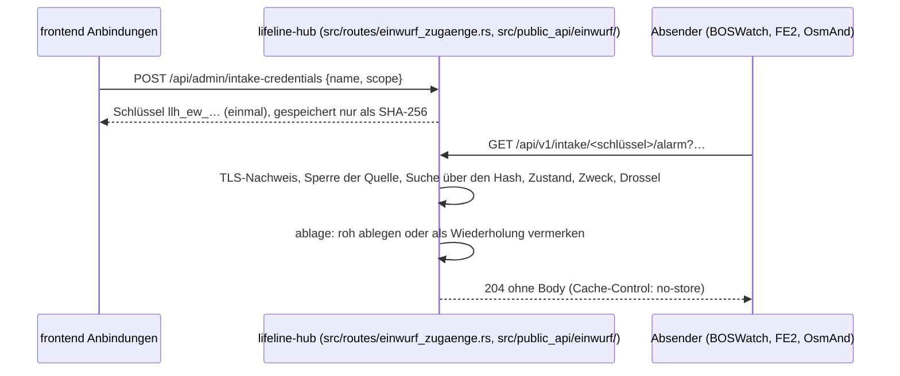

- Die Reihenfolge der Prüfungen steht an einer Stelle (`check_einwurf` in
  `src/public_api/einwurf/routen.rs`): Der TLS-Nachweis (`is_tls_nachgewiesen`, `src/extract.rs`) kommt
  vor der Suche, damit eine Klartext-Anfrage kein Orakel für Schlüssel ist.
- Eine Alarmmeldung wird nicht gedeutet. Mit `message_id` ist sie dauerhaft idempotent, mit
  `external_id` allein bei gleichem Inhalt; ohne Kennung gilt gleicher Inhalt desselben Zugangs
  zwei Minuten lang als Wiederholung und wird am Eintrag gezählt (`alarmmeldung_ablegen` in
  `src/public_api/einwurf/ablage.rs`). Den Einsatzvorschlag baut LLH-1192 auf der Ablage.
- Eine Position ersetzt die letzte ihrer Kennung, wenn sie nicht älter ist (`position_ablegen`,
  Tabelle `position_letzte`); einen Verlauf gibt es nicht. Die Lagekarte liest die Ablage nicht;
  in ein Fahrzeug gelangt eine Position nur über die Ortung (§ 6.6e1).
- Der Span der Anfrage nennt den Pfad mit `***` statt des Schlüssels (`pfad_fuer_protokoll` in
  `src/app.rs`, `einwurf::maskiere_pfad`).
- Der Purge-Lauf löscht Alarmmeldungen nach 7 Tagen und Positionen nach 24 Stunden
  (`einwurf::purge`, aufgerufen in `src/einsatz/purge_scheduler.rs`).

## 6.6e1 Fahrzeugortung: vom Einwurf bis zur Lagekarte

Eine Position aus dem Einwurf bewegt den Marker eines Fahrzeugs nur, wenn die Organisation die
Ortung freigegeben hat (Org-Schalter „Ortung im Einsatz“ der Helfer-App, ADR-0101) und die Kennung
im laufenden Einsatz an das Einsatzfahrzeug gekoppelt ist (LLH-2091,
[ADR-0103](entscheidungen/ADR-0103-ortung-uebernimmt-positionen-nur-fuer-gekoppelte-fahrzeuge-laufender-einsaetze.md),
Design-Doc [`2026-11-24-fjftaovq-fahrzeugortung-design.md`](../superpowers/specs/2026-11-24-fjftaovq-fahrzeugortung-design.md),
Nachtrag 25.11.2026).

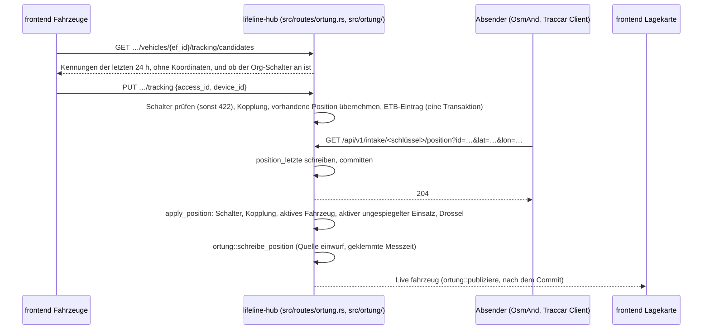

- Die Übernahme (`apply_position` in `src/ortung/uebernahme.rs`) läuft im Handler des Einwurfs
  nach dessen Commit und vor der Antwort, in eigener Transaktion; ihr Fehler wird verworfen, die
  Antwort bleibt `204` (ADR-0023). Nur ein Fahrzeug mit Kopplung, ohne `beendet_at`, in einem
  Einsatz mit `status = 'aktiv'` und `spiegel = 0` einer Org mit `ortung_im_einsatz = 1` wird
  geschrieben.
- Geschrieben wird über den Positionsbaustein (`ortung::schreibe_position`, Helfer-App) mit
  Quelle `einwurf` und der Messzeit des Geräts, mehr als 60 s in der Zukunft auf die Serverzeit
  geklemmt (`klemme_zeitpunkt`). Vorrang hat dessen Regel: ein älterer Zeitpunkt als
  `position_aktualisiert_at` wird verworfen; eine von Hand gesetzte Position trägt die Serverzeit
  und bleibt deshalb stehen, bis ein später gemessener Fix kommt.
- Die Drossel (`ORTUNG_DROSSEL_S`, 15 s je Fahrzeug) vergleicht die Messzeit des Fixes mit
  `position_aktualisiert_at` der gespeicherten Einwurf-Position; ein zu früher Fix wird nicht
  geschrieben, sondern merkt genau einen Nachlauf vor (`schedule_nachlauf`, nur im Speicher), der
  die jüngste Position nach Ablauf übernimmt.
- Die Kopplung endet mit Trennen (`DELETE …/tracking`), Entlassen, Stornieren, Ablehnen der
  Einheit und Einsatzabschluss (`delete_kopplung_tx`, `beende_im_einsatz_tx`), jeweils mit einem
  ETB-Eintrag in derselben Transaktion. Der Abschluss ruft in derselben Transaktion erst
  `helfer::ende::beende_ortung_im_einsatz` (Personen), dann `beende_im_einsatz_tx`, das die
  Positionen der Quelle `einwurf` über `ortung::loesche_position` leert; die Route meldet die
  Fahrzeuge nach dem Commit live. „Rückgängig“ nach dem Entlassen stellt die Kopplung wieder her,
  wenn der Schalter an und die Kennung noch frei ist (`restore_ortung_tx` in
  `src/fahrzeug/disposition_repo.rs`).
- Die Tabelle `ortung_kopplung` ist lokal (`migrations/0381_fahrzeugortung.sql`); in einem
  gespiegelten Einsatz lässt sich nicht koppeln (409), und eine dortige Kopplung wird nicht
  übernommen. Die Position selbst steht in `lat`/`lon`, `position_quelle` und
  `position_aktualisiert_at` von `einsatz_fahrzeug` und läuft wie jede Fahrzeugänderung zu den
  Spiegeln.

## 6.6e2 Fahrzeugortung über den Hub: Positionen im Spiegelabgleich

Gespiegelte Einsätze liefern die Position nicht über den Einwurf: Ein an einen Hub gekoppeltes ELW
nimmt keinen Einwurf an, die Geräte melden an den Hub. Führt das ELW den Einsatz, holt es die
Positionen seiner gekoppelten Hub-Kennungen im Abgleich ab (LLH-2119, [ADR-0107](entscheidungen/ADR-0107-hub-liefert-positionen-nur-fuer-kennungen-die-das-fuehrende-elw-gekoppelt-hat.md),
Design-Doc [`2026-11-25-ypcadxzo-fahrzeugortung-spiegel-design.md`](../superpowers/specs/2026-11-25-ypcadxzo-fahrzeugortung-spiegel-design.md)).

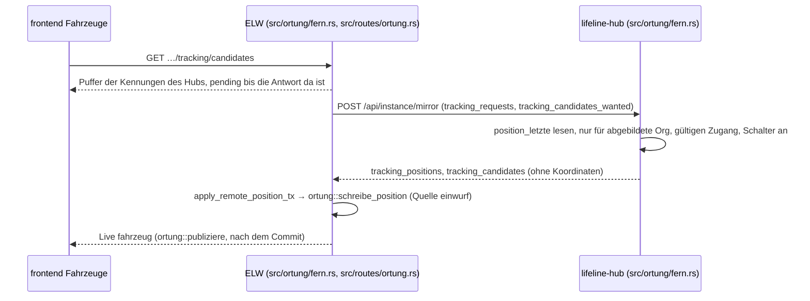

- **Koppeln am ELW:** `PUT …/tracking` liest `access_id` als Zugang des Hubs, wenn die Org einen Hub
  hat (`hub_fuer_org`); die Kennung muss im Kandidaten-Puffer stehen (sonst 422). Die Zeile in
  `ortung_kopplung` trägt dann `instanz_kopplung_id`, `fremder_zugang_id` und `zugang_name` statt
  `zugang_id` (`migrations/0386_ortung_kopplung_hub.sql`, eine Art je Zeile per `CHECK`). Die
  vorhandene Position kommt erst mit dem nächsten Abgleich; der Takt wird geweckt.
- **Kandidaten:** `src/ortung/fern.rs` hält je Org einen flüchtigen Puffer und einen Wunsch (60 s).
  Fehlt der Puffer oder ist er älter als 10 s, merkt die Route den Wunsch vor, weckt den Takt und
  antwortet mit `pending`; der Dialog fragt alle 2 s, höchstens 15 s.
- **Anfrage und Antwort:** `SpiegelPaket` trägt `tracking_requests`, `tracking_candidates_wanted`,
  `tracking_positions` und `tracking_candidates` (`src/instanz/spiegel/paket.rs`, `serde(default)`,
  höchstens `TRACKING_ANFRAGEN_MAX` Anfragen). Der Hub baut die Antwort in `answer_hub` nach dem
  Abgleich, rein lesend; ein Fehler zählt eine Sammelzeile und liefert leere Listen.
- **Übernahme:** nach dem Commit des Abgleichs in eigener Transaktion (`apply_answer`), über
  `apply_remote_position_tx` in `src/ortung/uebernahme.rs` mit denselben Regeln wie die lokale
  Übernahme (Schalter, aktives Fahrzeug, aktiver nicht gespiegelter Einsatz, Drossel 15 s). Einen
  Nachlauf gibt es hier nicht; der nächste Abgleich bringt die jüngste Position. Der Spiegel am Hub
  bekommt sie über die bestehenden Trigger.
- **Führungsabgabe:** `fuehrung::werde_spiegel` ruft `ortung::kopplung::beende_bei_fuehrungsabgabe_tx`
  neben `helfer::ende::beende_alle_im_einsatz`, vor dem Spiegel; alle Kopplungen des Einsatzes
  enden ohne ETB-Eintrag (ein Eintrag nach `bekannt_bis` wäre eine Bruchstelle). Die Position
  bleibt stehen und wird veraltet.

## 6.6f Ausgangsereignis: vom Schreiben bis zum Abruf

Ein Fremdsystem erfährt über `GET /api/v1/events`, dass sich an seinem freigegebenen Einsatz etwas
getan hat (LLH-1655,
[ADR-0038](entscheidungen/ADR-0038-ausgangsereignisse-fuer-fremdsysteme-entstehen-per-trigger-und-je-zugang.md),
Spec [`ereignis-abruf`](../../openspec/specs/ereignis-abruf/spec.md)).

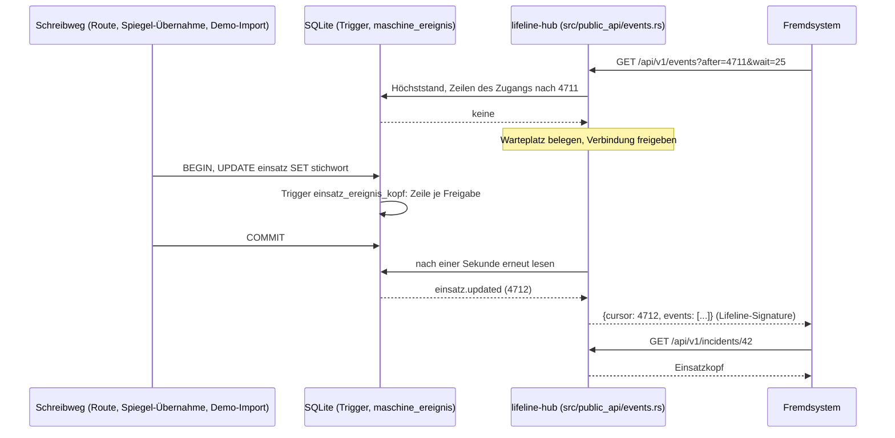

- Die Zeile entsteht im Trigger, in der Transaktion der Änderung
  (`migrations/0345_maschine_ereignis_trigger.sql`); ein Rollback nimmt sie mit. Kein Rust-Code
  schreibt in die Outbox.
- Geschrieben wird je Freigabe (`maschinenzugang_freigabe`), Änderungen nur für gültige
  Zugänge: Beginn der Freigabe ist `einsatz.created`, ihr Ende oder der Abschluss
  `einsatz.closed`. `lage.changed` hängt am Änderungslog `einsatz_aenderung` und an
  `einsatz_spiegel` (Ende des Abgleichs, Freigabestufe) und liegt je Zugang und Einsatz höchstens
  einmal vor. Jede Änderung der Rechte mit Einsatzbezug beendet die Freigabe.
- Der Abruf wird nicht geweckt: Er fragt im Takt nach (`events::TAKT`) und hält dazwischen keine
  Verbindung. Es warten höchstens `events::MAX_WARTENDE` Abrufe, je Zugang einer; ein weiterer
  antwortet sofort mit `Retry-After`.
- Der Cursor ist die fortlaufende Nummer. Der Purge-Lauf löscht nach sieben Tagen
  (`events::purge` in `src/einsatz/purge_scheduler.rs`) und hält die Löschgrenze in
  `maschine_ereignis_stand`; ein Cursor darunter ergibt `410 cursor_expired`, und das Fremdsystem
  baut neu auf: mit `einsaetze:read` über `GET /api/v1/incidents`, sonst über
  `GET /api/v1/events` ohne `after` und `GET /api/v1/situation`. Stand und Zeilen liest der Abruf aus
  einem Schnappschuss, damit ein Purge dazwischen keine Lücke ohne `410` lässt.

## 6.6g Adapter ruft ab

Ein Adapter holt im Hintergrund bei einem Fremdsystem ab (LLH-2017,
[ADR-0077](entscheidungen/ADR-0077-geheimnisse-der-adapter-liegen-nur-verschluesselt-und-adapter-rufen-nur-ueber-den-rahmen-ab.md)).

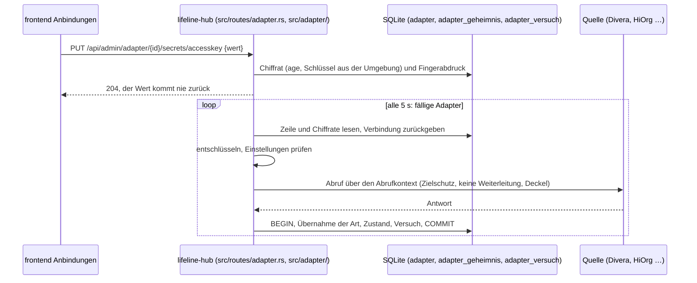

- Fällig ist ein aktiver Adapter einer bekannten Art, dessen nächster Abruf erreicht ist, und
  dessen Org sich nicht bei einem Hub meldet (`src/adapter/lauf.rs`). Je Durchgang höchstens vier
  Abrufe gleichzeitig, keiner doppelt.
- Ein vorübergehender Fehler setzt den nächsten Abruf nach `max(Intervall, min(60 s · 2^(n−1),
  15 min))`; ein Fehler, den ein Mensch beheben muss, hält an (`src/adapter/zustand.rs`). Ein
  neues Geheimnis oder geänderte Einstellungen machen einen so angehaltenen Adapter sofort
  wieder fällig.
- „Verbindung prüfen“ (`POST …/check`) ruft einmal ab, übernimmt nichts und lässt den Zustand;
  der Versuch steht im Verlauf (`lauf::probe`).

## 6.6h Fremdebene aus URL beim Lesen nachholen

Eine Fremdebene aus einer https-Adresse hat keinen Hintergrundlauf: der Server holt sie nach,
wenn jemand ihre Daten liest (LLH-2099,
[ADR-0102](entscheidungen/ADR-0102-geodaten-verlassen-das-system-aus-dem-client-fremde-nur-gepruef-ueber-den-server.md)).

```mermaid
sequenceDiagram
  participant FE as frontend Lagekarte (useFremdebenen)
  participant Hub as lifeline-hub (src/routes/karte_fremdebene.rs, src/karte_fremdebene/abruf.rs)
  participant DB as SQLite (karte_fremdebene, karte_fremdebene_daten)
  participant Q as Quelle (fremde https-Adresse)
  loop alle 60 s, nur sichtbare URL-Ebene und sichtbarer Tab
    FE->>Hub: GET …/map/foreign-layers/{ebeneId}/data (If-None-Match)
    Hub->>DB: Abrufstand lesen (versucht_at, ETag, Last-Modified)
    alt über 60 s seit dem letzten Versuch, führende Seite, Einsatz aktiv
      Hub->>Hub: Sperre je Ebene (Single-Flight), versucht_at neu prüfen
      Hub->>Q: bedingter Abruf über adapter::ziel (check_url, keine Weiterleitung, Deckel)
      Q-->>Hub: 200 mit Inhalt oder 304
      Hub->>DB: 200: normiertes GeoJSON ersetzen; immer: Abrufstand und Fehler setzen
    end
    Hub-->>FE: 200 mit ETag des gespeicherten Inhalts oder 304
  end
```

- Abgerufen wird nur auf der führenden Seite eines aktiven Einsatzes: nicht am Spiegel, nicht auf der Instanz,
  die die Führung einer anderen überlassen hat, nicht nach dem Abschluss
  (`is_hier_abzurufen` in `src/karte_fremdebene/abruf.rs`). Dort liest ein Spiegel nur, was
  gespeichert ist.
- Zwischen zwei Versuchen liegen mindestens 60 s (`FRISCH_SEKUNDEN`); gleichzeitige Leser teilen
  sich einen Abruf, weil je Ebene eine Sperre gilt und der Zeitpunkt des letzten Versuchs nach
  dem Warten neu geprüft wird.
- Die Antwort auf den Abruf ist bedingt (`If-None-Match`, `If-Modified-Since`): bei 304 ändert
  sich nur der Zeitpunkt des Abrufs, bei 200 ersetzt das neu normierte GeoJSON den Inhalt und ein
  Live-Ereignis `karte_fremdebene` geht an die Arbeitsplätze.
- Ein gestörter Abruf setzt nur den Fehlercode an der Ebene; der letzte gute Inhalt bleibt
  (ADR-0102). Ob der Server das eigene Netz abrufen darf, liest er bei jedem Abruf aus dem
  Org-Schalter `fremdebenen_lan_erlaubt` (`src/org/einstellungen.rs`), nicht aus der Ebene.
- Den Abruf stellt der Trait `FremdebeneAbrufer` bereit, Tests setzen einen zählenden ein; die
  URL steht nie in Log oder Fehlertext, nur `ebene_id` und der Fehlercode.
- Beim Anlegen aus einer URL holt der Server einmal synchron (Antwort 400 mit `grund` bei Fehler,
  ohne die URL zu nennen); eine Datei läuft durch den Virenscan (`src/anhang`) und denselben Parser.

## 6.6i Versand an eine Externe Stelle

Ein Mensch sendet ein freigegebenes Dokument per E-Mail (LLH-2093, [ADR-0104](entscheidungen/ADR-0104-nachrichten-an-menschen-gehen-nur-ueber-den-ausgangskorb.md)).

```mermaid
sequenceDiagram
  participant FE as frontend Senden-Dialog
  participant Hub as lifeline-hub (src/routes/ausgang.rs, src/ausgang/)
  participant DB as SQLite (ausgang, etb_eintrag)
  participant SMTP as Mailserver
  FE->>Hub: POST …/deliveries {client_id, recipients}
  Hub->>DB: Quelle, Stelle, Adresse, Anbindung prüfen; je Adresse eine Zeile (wartet)
  Hub-->>FE: 201 Versände; Lauf wird geweckt
  loop Takt 2 s und Wecken: fällige Zeilen (höchstens 4)
    Hub->>DB: Zeile, Anbindung und Quelle lesen, Verbindung zurückgeben
    Hub->>Hub: zugang_fuer_versand entschlüsselt das Passwort, Nachricht bauen
    Hub->>SMTP: STARTTLS oder TLS, MAIL, RCPT, DATA
    SMTP-->>Hub: 250 oder Fehler
    Hub->>DB: BEGIN, Ergebnis und ETB-Eintrag, COMMIT
    Hub-->>FE: Live-Ereignis ausgang (nach dem Commit)
  end
```

- Vor jeder Zustellung prüft der Lauf die Quelle (jüngste freigegebene Version, Nachforderung
  nicht zurückgezogen) und den Spiegel; ein überholter Versand geht ohne Netz auf
  `fehlgeschlagen` (`src/ausgang/lauf.rs`).
- Vorübergehende Fehler wiederholt der Lauf mit Backoff `30 s · 2^(n−1)` bis 5 min und höchstens
  30 min ab dem ersten Versuch; dauerhafte Fehler stehen sofort im ETB. Bricht die Verbindung
  nach DATA ab, ist der Versand `ungewiss` und wartet auf „Erneut senden“ durch einen Menschen
  (`src/ausgang/zustand.rs`).
- Beim Start behandelt `beim_start` eine mitten in der Zustellung unterbrochene Zeile wie
  `ungewiss`.

## 6.7 Kartenkacheln über Proxy, Cache und Offline-Karte

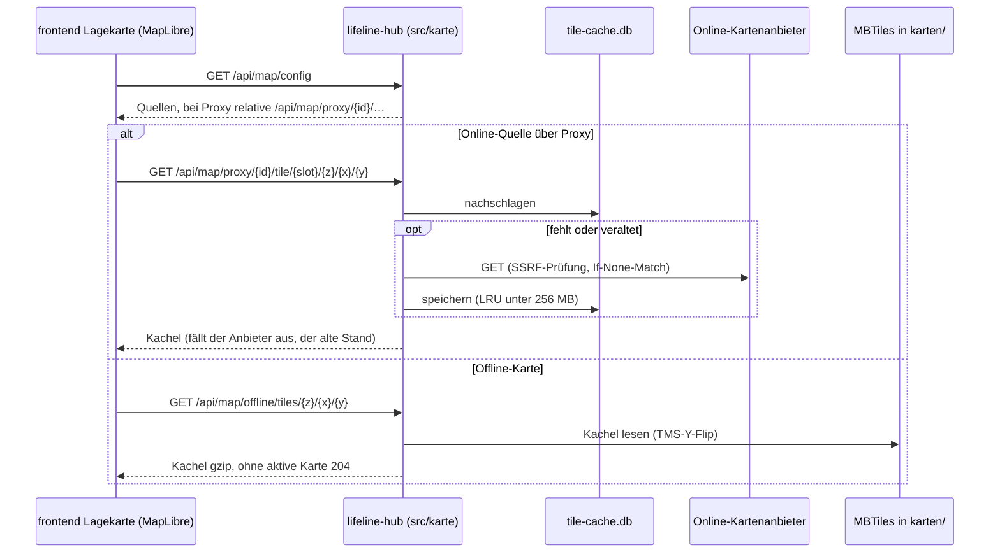

- Proxy `src/karte/proxy.rs`: ein Schlüssel in der URL des Anbieters bleibt auf dem Server.
  Cache `src/karte/tile_cache.rs`: `TILE_CACHE_CAP_BYTES` = 256 MB in `<karten_dir>/tile-cache.db`;
  gleichzeitige Fehlgriffe auf dieselbe URL teilen sich einen Abruf (LFH-930, Modulkopf).
- Offline-Karten `src/karte/mbtiles.rs`; Glyphs und Sprite sind eingebettet
  (`/api/map/offline/{fonts,sprites}/…`). Das Frontend wählt online, dann offline, sonst den
  Blind-Modus ([`docs/betrieb/packaging.md`](../betrieb/packaging.md), „Lagekarte / Basemap“).
- Bezug: Der Admin lädt eine Karte aus dem Katalog (`src/karte/katalog.rs`,
  `crates/karten-katalog`) per SHA256-Pin nach `karten/` (`src/karte/download.rs`).
  `POST /api/map/offline-maps/build` reicht einen Bauauftrag mit Token an
  `POST {url}/builds` des `karten-service` weiter (`src/routes/karte.rs`). Der baut mit `make`
  und Docker aus `karten-build` (`karten-service/src/build/make_runner.rs`) und lädt Ergebnis und
  Manifest in den Objektspeicher (`karten-service/src/storage/s3.rs`). Spec:
  [`openspec/specs/offline-karten-aktualisierung/`](../../openspec/specs/offline-karten-aktualisierung/spec.md).

## 6.8 Benachrichtigung und Web Push

```mermaid
sequenceDiagram
  participant BE as lifeline-hub (Schreibweg, Scheduler)
  participant N as src/benachrichtigung
  participant Hub as LiveHub
  participant WP as src/web_push
  participant PD as Push-Dienst des Browsers
  participant FE as frontend (Tab offen)
  participant SW as Service Worker (alarm-sw.js)
  BE->>N: melden(Anlass) nach dem Commit
  N->>N: aufloesung::empfaenger, je Empfänger eine Zeile
  N->>Hub: zustellen: event benachrichtigung
  Hub-->>FE: nur an Verbindungen der Empfänger
  FE->>FE: Zentrale: Toast, Ton, ggf. OS-Meldung
  opt --web-push
    N->>WP: versenden (nur Kennungen, RFC 8291)
    WP->>PD: POST an den Abo-Endpunkt
    PD-->>SW: push
    SW->>BE: GET /api/notifications/{id} (mit Sitzung)
    SW->>SW: showNotification (Tag wie im Tab)
  end
```

- Wer eine Benachrichtigung bekommt, entscheidet allein `melden` (`src/benachrichtigung/mod.rs`);
  den Text bildet der Server erst beim Lesen (`src/benachrichtigung/text.rs`).
- `frontend/src/live/benachrichtigungListener.ts` leitet nur weiter; Ton, Toast und Meldung
  entscheidet `frontend/src/alarm/useBenachrichtigungen.ts`. In der Desktop-App zeigt
  `benachrichtigung_zeigen` die Meldung über das Betriebssystem (`src-tauri/AGENTS.md`).
- Web Push nur mit `--web-push` (`src/main.rs`): höchstens 8 Versände gleichzeitig, 10 s
  Zeitlimit, der Push-Dienst hält die Nachricht 12 h, Abos nur bei Hosts in `PUSH_DIENSTE`
  (`src/web_push/mod.rs`). Erreicht der Service Worker den Server nicht, zeigt er den Titel der
  Stufe (`frontend/public/alarm-sw.js`).
- Ohne Einsatz meldet nur der Adapter-Lauf (LLH-2026,
  [ADR-0086](entscheidungen/ADR-0086-stoerungen-einer-anbindung-melden-sich-am-ort-adapter-einmal-an-die-admins-der-org.md)):
  `adapter::lauf` setzt in seiner Transaktion den Merker `adapter.gemeldet` und ruft danach
  `melden(Anlass::adapter(…))`; Empfänger, Leserecht und Text stehen in
  `src/benachrichtigung/adapter.rs`, zugestellt wird über den Org-Kanal, nie über den Hub.
- Specs: [`benachrichtigungen`](../../openspec/specs/benachrichtigungen/spec.md),
  [`web-push`](../../openspec/specs/web-push/spec.md); Betrieb:
  [`docs/betrieb/web-push.md`](../betrieb/web-push.md).

### 6.8a Hinweis über den Hub

Führt ein gekoppelter ELW den Einsatz, reist der Anlass im Abgleich zum Hub, und der Hub meldet
für seine eigenen Empfänger (LLH-1495,
[ADR-0027](entscheidungen/ADR-0027-hinweise-eines-gefuehrten-einsatzes-reisen-als-anlass-zum-hub.md)).

```mermaid
sequenceDiagram
  participant EN as ELW src/benachrichtigung
  participant EA as ELW src/instanz/spiegel/hinweis.rs
  participant ET as ELW src/instanz/spiegel/takt.rs
  participant H as Hub src/instanz/spiegel/abgleich.rs
  participant HN as Hub src/benachrichtigung
  EN->>EA: melden(Anlass): ziele, vormerken (hinweis_ausgang)
  EA->>ET: wecken
  EN->>EN: Zeilen und Live wie immer; Push an alle, die der Hub nicht erreicht
  ET->>H: POST /api/instance/mirror {lieferungen, hinweise}
  H->>H: Zeilen übernehmen, dann hinweis::annehmen (abbilden, hinweis_eingang)
  H-->>ET: hinweis_quittungen (ELW löscht sie aus dem Ausgang)
  H->>HN: nach dem Commit melden bzw. erledigen
  HN->>HN: Empfänger am Hub, Zeilen, Live, Web Push mit Kennungen des Hubs
```

- Ob der Hub Hinweise annimmt und Push anbietet, nennt er in der Meldeantwort je Kanal
  (`MeldenAntwort.hinweise`, `web_push`, `ios_push`); die meldende Seite merkt es an der Kopplung.
- Sperrt das Push-Relais den Hub, nennt er es mit (`MeldenAntwort.ios_push_gesperrt_seit`,
  LLH-2074). Der ELW merkt es an der Kopplung und zeigt es an jedem Einsatz, dessen Hinweise über
  diesen Hub reisen (`EinsatzAnzeige.ios_push_hub_gesperrt`, Band für Einsatzleitung und Admins),
  pusht Hub-Konten aber nicht selbst: ihre Geräte sind am Hub angemeldet. Beginn und Ende der
  Sperre melden den Einsatzkopf (`hinweis::sperre_melden`); Entscheidung:
  [ADR-0095](entscheidungen/ADR-0095-ein-am-relais-gesperrter-hub-wird-am-elw-angezeigt-nicht-ersetzt.md).
- Bietet der Hub einen Kanal an, lässt der ELW den Push in diesem Kanal nur an Konten aus, die aus
  der Kopplung stammen (`hinweis::konten_am_hub` mit `hinweis::Kanal`). Konten nur am ELW, einen
  Kanal, den der Hub nicht anbietet, und ein gescheitertes Vormerken pusht er selbst.
- Was am Spiegel noch fehlt, bleibt ohne Quittung und kommt mit dem nächsten Abgleich wieder;
  nach 12 Stunden geht ein Anlass nicht mehr hinaus (`hinweis::NACHREICHEN_STUNDEN`).

### 6.8b iOS-Push: anmelden, senden, tippen

Die iOS-App bekommt Benachrichtigungen bei geschlossener App über das Push-Relais und APNs
(LLH-1981, [ADR-0090](entscheidungen/ADR-0090-ios-push-laeuft-ueber-ein-relais-mit-ende-zu-ende-verschluesselter-nutzlast.md)).

```mermaid
sequenceDiagram
  participant FE as frontend (alarm/iosPush.ts)
  participant IOS as ios (Brücke, App)
  participant BE as lifeline-hub (src/routes/ios_push.rs)
  participant IP as src/ios_push
  participant R as push-relais
  participant A as APNs
  participant NSE as ios/Benachrichtigungsdienst
  FE->>IOS: push_register
  IOS->>IOS: Berechtigung, Token; je Server Kennung und Schlüssel (Schlüsselbund)
  IOS-->>FE: registration_id, token, environment, key
  FE->>BE: PUT /api/ios-push/registration (mit inhalt, stumm)
  BE->>BE: Upsert auf token, an Konto und Gerät
  Note over BE,IP: später: benachrichtigung::ausliefern
  BE->>IP: versenden (eigener Task, Filter wie Web Push)
  IP->>IP: Klartext wie GET /api/notifications/{id}, AES-256-GCM je Gerät
  opt noch kein Zugang
    IP->>R: POST /v1/server
    R-->>IP: server_id, geheimnis
  end
  IP->>R: POST /v1/senden (höchstens 100, Bearer)
  R->>A: HTTP/2 /3/device/{token}: Rückfalltitel, Umschlag l
  R-->>IP: ergebnisse (token_ungueltig löscht die Anmeldung)
  A-->>NSE: Push (mutable-content)
  NSE->>NSE: Schlüssel zur Kennung, öffnen, Titel, Detail, Thread setzen
  IOS->>IOS: Tippen: Kennung → Server, Pfad über Linkregeln.sichererPfad
  IOS->>BE: Pfad im Webview des Servers laden (anderer Server: sichtbar wechseln)
```

- Ohne `--ios-push` richtet `src/main.rs` keinen Client ein: kein Kontakt zum Relais, die Routen
  antworten 404. Der Server meldet sich erst beim ersten Versand selbst an
  (`IosPush::zugang` in `src/ios_push/mod.rs`); `401` vom Relais führt zu einer neuen Anmeldung,
  `403` (gesperrt) beendet den Versand für `SPERRE_GILT_STUNDEN` (24 h), danach versucht der
  nächste Versand es einmal mit demselben Zugang (angenommen: Sperre weg; wieder `403`: sie gilt
  ab jetzt neu). Solange sie steht, meldet `GET /api/ios-push` `relais_gesperrt`, und
  `GET /api/admin/instance` nennt sie für die Warnung auf der Seite „Instanzkopplung“.
- Das Relais setzt `apns-expiration` auf 12 Stunden, `apns-priority` 10 und für einen Alarm
  `interruption-level: time-sensitive`, für einen Hinweis `active` (`push-relais/src/apns.rs`).
  Ohne Extension oder Schlüssel bleibt der Rückfalltitel „Alarm“ bzw. „Neue Benachrichtigung“.
- Bei offener App zeigt die App eine Push-Meldung des aktiven Servers nicht als Banner, die
  Oberfläche meldet sie über den Live-Kanal; Meldungen anderer Server erscheinen
  (`Meldungsdelegat` in `ios/App/LifelineHubApp.swift`). Ein Tippen beim Kaltstart wartet, bis der
  Start steht (`Meldungsweg`). Auf der gespeicherten Oberfläche ohne Server (6.5) prüft die App wie
  auf jeder Status-Seite erst den Server und lädt den Pfad danach; antwortet er nicht, startet die
  gespeicherte Oberfläche wieder, ohne den Pfad (`meldungAngetippt` in
  `ios/LifelineKern/Sources/LifelineKern/Ablauf.swift`).
- Regeln zu Versand, Ende der Anmeldung und Kopplung je Kanal:
  [`src/AGENTS.md`](../../src/AGENTS.md), Abschnitt „iOS-Push“; Hülle:
  [`ios/AGENTS.md`](../../ios/AGENTS.md), „Push über APNs“; Betrieb:
  [`docs/betrieb/push-relais.md`](../betrieb/push-relais.md).
