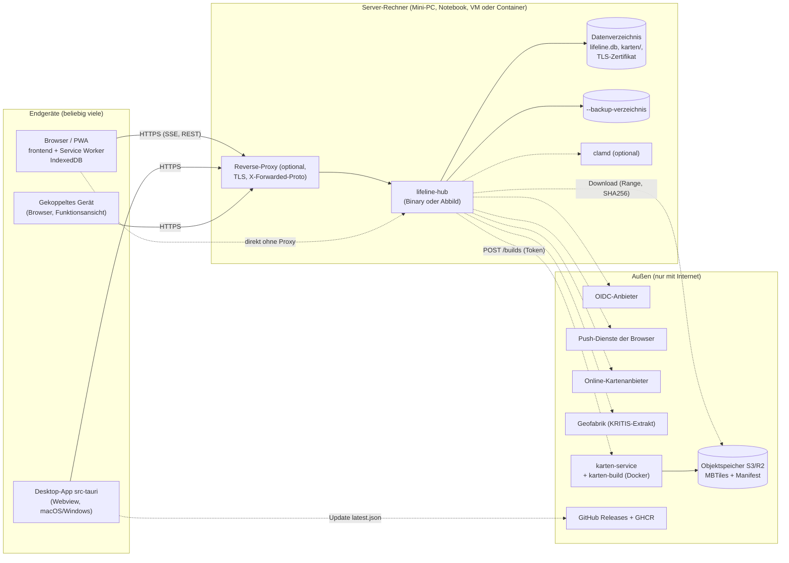
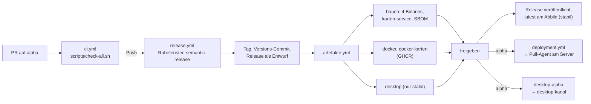

# 7. Verteilungssicht

Stand: 23.10.2026 (alpha dcc500f5).

Lifeline Hub läuft als **ein Serverprozess** (`lifeline-hub`) mit eingebettetem Frontend und
SQLite. Die Endgeräte greifen über Browser, installierte PWA oder Desktop-App darauf zu. Einen
festen Einsatzrechner gibt es nicht ([`docs/betrieb/packaging.md`](../betrieb/packaging.md),
„Datenträger: Mindest-Schreibrate“). Den Server trägt ein Mini-PC oder Notebook im
Einsatzleitwagen genauso wie ein Container beim Hoster. Gebaut werden vier Server-Plattformen
und zwei Container-Architekturen (7.2).

## 7.1 Überblick

Gestrichelte Pfeile sind optional oder brauchen Internet. Ohne Internet läuft der Server weiter:
Offline-Karten liegen in `karten/`, der Rest scheitert still oder ist abgeschaltet (6.7).

## 7.2 Auslieferungsformen

| Form | Inhalt | Beleg |
| --- | --- | --- |
| Server-Binary | eine Datei mit API, eingebettetem `frontend/dist`, SQLite und OpenSSL statisch; Ziele `x86_64-unknown-linux-gnu`, `aarch64-unknown-linux-gnu`, `aarch64-apple-darwin`, `x86_64-pc-windows-gnu` | `src/static_files.rs` (`#[folder = "frontend/dist"]`), Matrix in `.github/workflows/artefakte.yml`, [`packaging.md`](../betrieb/packaging.md) |
| Container-Abbild `ghcr.io/rubenvitt/lifeline-hub` | dieselbe Linux-Binary auf `distroless/cc-debian13:nonroot`, `linux/amd64` und `linux/arm64`, kein Build im Abbild | `Dockerfile`, Job `docker` in `artefakte.yml` |
| PWA im Browser | dasselbe Frontend, vom Server ausgeliefert; installierbar und offline nur im sicheren Kontext | `frontend/vite.config.ts` (`VitePWA`), [`packaging.md`](../betrieb/packaging.md), „Lokaler Betrieb“ |
| Desktop-App | Tauri-Hülle ohne Anwendungslogik, lädt die https-Adresse des Servers; macOS ab 14 arm64 (`.dmg`, signiert und notarisiert), Windows 10/11 x64 (`-setup.exe`, nicht signiert); Linux wird nur übersetzt | `src-tauri/tauri.conf.json`, `.github/workflows/desktop.yml`, [`desktop-app.md`](../betrieb/desktop-app.md) |
| `karten-service` | Region-Build-Dienst; Linux-Binary und Abbild `ghcr.io/rubenvitt/lifeline-hub-karten-service` auf `debian:13-slim` mit `make`, `sqlite3` und Docker-CLI | `karten-service/Dockerfile`, Job `docker-karten` in `artefakte.yml`, [Runbook](../ops/lfh-204-karten-service-ops-runbook.md) |
| `website` | statische Astro-Seite auf Cloudflare Pages, Produktions-Branch `alpha`, nicht im Binary | [`website/AGENTS.md`](../../website/AGENTS.md) |

`compose.yml` und `garage.toml` sind **reine Entwicklungsinfrastruktur**: ein lokaler
S3-kompatibler Objektspeicher (Garage) für den `karten-service`. Der Server selbst braucht
kein Docker (Kopf von `compose.yml`).

## 7.3 Prozesse und Ports

| Prozess | Port (Vorgabe) | Beleg |
| --- | --- | --- |
| `lifeline-hub` | `127.0.0.1:8080` (`--bind`, `LIFELINE_BIND`); im Abbild `0.0.0.0:8080`. `--tls` ändert den Port nicht | `src/config.rs`, `Dockerfile`, [`betrieb-tls.md`](../betrieb-tls.md) |
| `lifeline-hub` Health | `GET /api/health`: 200 mit Version, 503 ohne Datenbank | `src/routes/health.rs` |
| `karten-service` | `0.0.0.0:8088` (`KS_BIND`), `GET /healthz`, Bearer-Token `KS_TOKEN` | `karten-service/src/config.rs`, `karten-service/src/api.rs` |
| Garage (nur Dev) | `3900` S3-API, `3902` unsignierter Lesepfad | `compose.yml` |

Der Server begrenzt sich selbst: höchstens 1024 Verbindungen, Kopflesefrist 15 s, HTTP/1-Köpfe
bis 32 KiB (`src/verbindung.rs`). Er stellt sich nicht per mDNS vor; der Hostname kommt vom
Betriebssystem oder vom lokalen DNS ([`packaging.md`](../betrieb/packaging.md), „Lokaler
Betrieb“). Beim Herunterfahren bekommen offene Verbindungen 10 s, eine laufende Sicherung bis
45 s und das Schließen des Pools bis 10 s (`src/main.rs`).

## 7.4 Speicherorte

| Ort | Inhalt | Beleg |
| --- | --- | --- |
| `--db-path` (Vorgabe `lifeline.db`, Abbild `/data/lifeline.db`) | Datenbank im WAL-Modus; Anhänge als BLOB in der Tabelle `anhang`, Schlüssel des Web Push | `src/config.rs`, `migrations/0052_anhang.sql`, `src/web_push/mod.rs` |
| `<Verzeichnis von --db-path>/karten` | Offline-Karten (MBTiles), `tile-cache.db`, Welt-Übersicht, `kritis/` | `default_karten_dir` in `src/config.rs`, `src/karte/tile_cache.rs`, `src/karte/kritis/scheduler.rs` |
| neben der Datenbank | `lifeline-tls-cert.pem`/`lifeline-tls-key.pem` (Zertifikat-Cache), `lifeline-download-…` (Kopie für den Sicherungs-Download) | `src/tls/mod.rs`, `src/backup/mod.rs` |
| `--backup-verzeichnis` | automatische Sicherungen, Vorgabe alle 360 min, 7 behalten, mit `--backup-empfaenger` per age verschlüsselt | `src/config.rs`, [`backup-restore.md`](../betrieb/backup-restore.md) |
| Endgerät, Browserprofil oder Webview | IndexedDB `lifeline-lagebild`, `lifeline-offline`, `lifeline-ortcache`, ETB-Entwürfe; Liste aller Orte in `GERAETESPEICHER` | `frontend/src/offline/geraetRaeumung.ts`, [`endgeraete.md`](../betrieb/endgeraete.md) |
| Desktop-App | `verbindung.json` (Server, `bekannt`), `kanal.json` (Update-Kanal) im App-Konfigurationsverzeichnis (`app_config_dir`, Kennung `dev.rubeen.lifeline.desktop`) | `src-tauri/src/verbindung.rs`, `src-tauri/src/kanal.rs`, [`desktop-app.md`](../betrieb/desktop-app.md) |
| `karten-service` | Volume `/opt/karten-build/out`, Ergebnis im Objektspeicher | `karten-service/Dockerfile`, `karten-service/src/storage/s3.rs` |

Das Abbild legt Datenbank und `karten/` auf **ein** Volume `/data`, weil der Kartenpfad aus dem
Datenbankpfad folgt (`Dockerfile`). Datenbank, Sicherungen und Swap gehören auf einen
verschlüsselten Datenträger; die Anwendung verschlüsselt nicht selbst und prüft das stündlich
([`packaging.md`](../betrieb/packaging.md), „Datenträgerverschlüsselung ist Pflicht“).

## 7.5 TLS

| Betriebsart | Verhalten | Beleg |
| --- | --- | --- |
| eigenes TLS (`--tls`) | Zertifikat in der Reihenfolge eigenes Paar, Cache neben der DB, `mkcert`, selbst signiert (`rcgen`); `--bind` muss IP:Port sein; HTTP/2 per ALPN | `src/tls/mod.rs`, `src/main.rs`, [`betrieb-tls.md`](../betrieb-tls.md) |
| hinter einem Reverse-Proxy | `X-Forwarded-Proto: https` setzt `Secure` je Anfrage; `--trusted-proxies` legt fest, wem `X-Forwarded-For` geglaubt wird | `SichererTransport` (`src/auth/session.rs`), `extract::init_vertraute_proxys` (`src/main.rs`) |
| Klartext-HTTP | funktioniert, aber ohne Service Worker, PWA, Passkey und Eigenposition | [`packaging.md`](../betrieb/packaging.md), „Lokaler Betrieb“ |

Die Desktop-App nimmt nur `https` mit Hostnamen an ([`desktop-app.md`](../betrieb/desktop-app.md),
„Erster Start“). Ohne HTTP/2 teilen sich alle Tabs eines Profils etwa sechs Verbindungen je Origin; jede offene
SSE-Verbindung belegt eine davon ([`betrieb-tls.md`](../betrieb-tls.md), LFH-264).

## 7.6 Konfiguration

Der Server liest seine Konfiguration nur in `src/config.rs` aus Flags oder `LIFELINE_*`. Die
vollständige Liste gibt `lifeline-hub --help` aus. Welche Schalter eine Vertrauensgrenze
verschieben, steht in [`docs/betrieb/env-registry.md`](../betrieb/env-registry.md). Den
`karten-service` konfigurieren `KS_*` und `AWS_*` (`karten-service/src/config.rs`,
[Runbook](../ops/lfh-204-karten-service-ops-runbook.md)). Die Kartenquellen stehen nicht in der
Umgebung, sondern in der Datenbank und werden unter `/admin/karten` gepflegt
([`packaging.md`](../betrieb/packaging.md), „Lagekarte / Basemap“).

Diese ausgehenden Verbindungen hängen an Schaltern (Vorgaben aus `src/config.rs`):

| Ziel | Schalter, Vorgabe |
| --- | --- |
| Geofabrik-Extrakt für KRITIS (rund 4–5 GB je neuem Stand) | `--kritis-extrakt` an, alle 168 h |
| Katalog und neue Stände der Offline-Karten | `--karten-auto-aktualisierung` an, alle 6 h |
| `karten-service` | `--karten-service-url` und `--karten-service-token`, beide nötig |
| clamd | `--clamav-addr`, ohne Angabe ungescannt; nicht erreichbar → 503 außer `--clamav-fail-open` |
| Push-Dienste der Browser | `--web-push` aus |
| OIDC-Anbieter | alle vier `--oidc-*` gesetzt |

## 7.7 Release-Kette und Kanäle

| Kanal | Branch | Version | Desktop-Update liest |
| --- | --- | --- | --- |
| Vorabversion | `alpha` (Default-Branch, jeder Merge) | `X.Y.Z-alpha.N` | Release `desktop-alpha`, `latest.json` |
| Beta | `beta`, vorbereitet, existiert nicht | — | — |
| Stabil | `main`, nur durch Merge `alpha → main` | `X.Y.Z` | `releases/latest/download/latest.json` |

- Kanäle und Versionsquelle: `release.config.mjs`. `prepareCmd` setzt die Version in
  `Cargo.toml` und `frontend/package.json`; Server und Hülle erben sie aus `[workspace.package]`.
  `release.yml` läuft nur nach grünem Gate bei einem Push (`ci.yml`, Job `release`).
- Ein Release erscheint erst, wenn alle Bau-, Abbild- und bei stabilen Tags auch Desktop-Jobs
  grün sind (Job `freigeben`, Kopf von `artefakte.yml`). Die Desktop-Pakete einer Alpha
  entstehen danach und halten nichts auf (Job `desktop-alpha` in `artefakte.yml`, `desktop.yml`).
- `deployment.yml` rollt nichts aus: es legt ein GitHub-Deployment an, das ein Pull-Agent auf dem
  Zielserver abholt. Der Agent liegt nicht in diesem Repo (Kopf von `deployment.yml`).
- Regeln für Release-Skripte: [`scripts/AGENTS.md`](../../scripts/AGENTS.md); Ablauf und
  Signaturschlüssel der Desktop-App: [`desktop-app.md`](../betrieb/desktop-app.md).

## 7.8 Beobachtbarkeit und Betrieb

- Logs gehen auf stdout, nicht blockierend mit höchstens 16 Ki Zeilen Puffer; bei Stau fallen
  Zeilen weg (`src/main.rs`). Request-ID, Log-Flut-Schutz, Auth-Audit, Admin-Spur und
  Zugangsprotokoll: [`docs/betrieb/observability.md`](../betrieb/observability.md).
- Die Datenträgerprüfung meldet einen unverschlüsselten oder unbekannten Ort im Log und in einer
  Warnleiste für System-Admins (`src/datentraeger/mod.rs`, [`packaging.md`](../betrieb/packaging.md)).
- Sicherung im laufenden Betrieb über `VACUUM INTO`, Download unter `/api/backup`, Unterkommandos
  `backup` und `restore`: [`docs/betrieb/backup-restore.md`](../betrieb/backup-restore.md).
- Vorgaben für Endgeräte (Verschlüsselung, Bildschirmsperre, Gemeinschaftsgeräte, Verlust):
  [`docs/betrieb/endgeraete.md`](../betrieb/endgeraete.md). Web Push:
  [`docs/betrieb/web-push.md`](../betrieb/web-push.md).
