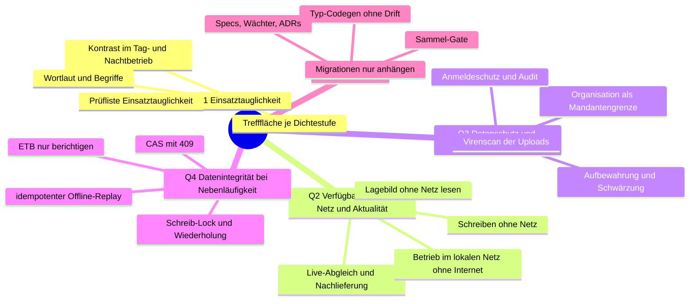

# 10. Qualitätsanforderungen

Stand: 23.10.2026 (alpha dcc500f5).

Die fünf Qualitätsziele Q1 bis Q5 stehen in [Einführung und Ziele](01-einfuehrung-und-ziele.md),
Abschnitt 1.2. Dieses Kapitel verfeinert sie zu einem Qualitätsbaum und macht sie mit Szenarien
prüfbar. Jedes Maß ist am Code belegt: durch einen Test, eine Anforderung mit SHALL oder MUST in
`openspec/specs/`, einen Schritt des Sammel-Gates oder eine verbindliche Leitlinie. Zahlen stehen
nur da, wo die genannte Quelle sie festlegt.

## 10.1 Qualitätsbaum

| Ziel | Verfeinerung | Getragen von |
| --- | --- | --- |
| Q1 | Lesbarkeit, Bedienbarkeit mit Handschuh und unter Zeitdruck | [Querschnitt 8.21 bis 8.24](08-querschnittliche-konzepte.md), [`frontend/AGENTS.md`](../../frontend/AGENTS.md), Abschnitt „Bedien-Leitlinie“ |
| Q2 | Lesen und Erfassen bei Funkloch, aktuelles Lagebild in jedem Tab, Server ohne Internet | [`frontend/src/offline/AGENTS.md`](../../frontend/src/offline/AGENTS.md), Spec [`live-abgleich`](../../openspec/specs/live-abgleich/spec.md), [`README.md`](../../README.md), Abschnitt „Warum überhaupt“ |
| Q3 | Daten nur für Berechtigte, Löschung nach Frist, nachvollziehbare Zugänge | [`src/AGENTS.md`](../../src/AGENTS.md), Abschnitte „Aufbewahrung“, „Admin-Spur“, „ClamAV-Upload-Scan“ |
| Q4 | Keine verlorene oder doppelte Änderung bei gleichzeitiger Arbeit | `src/tx.rs`, [`src/AGENTS.md`](../../src/AGENTS.md), Abschnitt „Statuscode-Konvention“, Spec [`etb-berichtigung`](../../openspec/specs/etb-berichtigung/spec.md) |
| Q5 | Änderungen bleiben sicher, weil Gates Drift rot machen | `scripts/check-all.sh`, [Wurzel-`AGENTS.md`](../../AGENTS.md), Abschnitte „Qualitäts-Gates“ und „Migrationsvergabe“ |

## 10.2 Qualitätsszenarien

Jede Zeile liest sich als Quelle → Stimulus → Reaktion → Maß; die letzte Spalte nennt den Beleg.

| Nr. | Ziel | Quelle und Stimulus | Reaktion | Maß | Beleg |
| --- | --- | --- | --- | --- | --- |
| S1 | Q1 | Eine Einsatzkraft liest Text in jeder Textstufe, auch Gefahrrot, im Tag- oder Nachtbetrieb. | Der Text bleibt gegen jede deckende Fläche lesbar. | Kontrast im Tagbetrieb mindestens 7 : 1, im Nachtbetrieb mindestens 5 : 1. | Specs [`textstufen-kontrast`](../../openspec/specs/textstufen-kontrast/spec.md) und [`farbrollen-kontrast`](../../openspec/specs/farbrollen-kontrast/spec.md); `frontend/src/theme/textstufen.test.ts`, `frontend/src/theme/gefahrKontrast.test.ts` |
| S2 | Q1 | Eine Führungskraft bedient ein Tablet mit Handschuhen und wählt die Dichtestufe `handschuh`. | Jedes genannte Bedienziel ist groß genug zum Treffen. | Mindestens die Steuerhöhe der Stufe: 30 / 48 / 72 px für `kompakt` / `komfortabel` / `handschuh`. | Spec [`einsatztauglichkeit-layout`](../../openspec/specs/einsatztauglichkeit-layout/spec.md), „Trefffläche folgt der Dichtestufe“; `frontend/e2e/gate3-trefflaeche.spec.ts` |
| S3 | Q1 | Ein Entwickler baut eine neue Seite oder ein Modul um. | Die Seite durchläuft vor „fertig“ die Prüfliste Einsatztauglichkeit. | Alle 15 Kriterien tragen ein Verdikt (erfüllt, offen mit Zielticket, nicht anwendbar); „nicht geprüft“ zählt nicht. | [`frontend/AGENTS.md`](../../frontend/AGENTS.md), Abschnitt „Bedien-Leitlinie“; Prüfliste in [`docs/superpowers/specs/2026-07-25-bedien-leitlinie-einsatzkontexte.md`](../superpowers/specs/2026-07-25-bedien-leitlinie-einsatzkontexte.md) |
| S4 | Q2 | Ein Tab verliert kurz die Verbindung und baut den Einsatz-Strom mit seiner letzten Position wieder auf. | Der Server liefert genau das Verpasste nach; liegt die Position vor dem Ring, gleicht der Tab voll ab. | Ring von 256 Nachrichten je Einsatz, Kanal bleibt nach dem letzten Empfänger 10 min stehen. | `REPLAY_KAPAZITAET`, `REPLAY_KARENZ` in `src/live/mod.rs`; `tests/live_feed.rs`, `neuverbinden_mit_der_position_holt_genau_das_verpasste` |
| S5 | Q2 | Nach einem Funkloch treffen 50 ETB-Ereignisse binnen 200 ms ein. | Der Tab fasst sie zusammen und ruft nicht für jedes Ereignis neu ab. | Sammelfenster höchstens 500 ms, jede betroffene Abfrage höchstens einmal neu abgerufen. | Spec [`live-abgleich`](../../openspec/specs/live-abgleich/spec.md), „Live-Ereignisse werden gebündelt abgeglichen“; `frontend/src/live/liveInvalidierung.test.ts` |
| S6 | Q2 | Ein Gerät startet ohne Netz neu. | ETB, Meldebild, Betroffene, Aufträge und Lagekarte zeigen den vorgehaltenen Stand; ein zu alter Stand wird samt Identität verworfen. | Gültig bis 24 h nach der letzten erfolgreichen Server-Antwort, lokale Vormerkungen verlängern die Frist nicht. | Spec [`lagebild-offline-lesen`](../../openspec/specs/lagebild-offline-lesen/spec.md), „Höchstliegezeit von 24 Stunden“; `frontend/src/offline/lagebildStart.test.ts` |
| S7 | Q3 | Ein Benutzer einer anderen Organisation ruft einen Einsatz über seine Kennung auf. | Der Server liefert keine Daten des fremden Einsatzes. | Antwort 403 oder 404; jede Route unter `/api/einsaetze/{id}/…` zieht den Org-Floor. | `tests/cross_org.rs`; `tests/einsatz_kontext_guard.rs`; `src/einsatz/kontext.rs` |
| S8 | Q3 | Ein Angreifer probiert Passwörter, auch hinter einem Proxy mit gefälschtem `X-Forwarded-For`. | Die Quelle wird gesperrt, andere Adressen bleiben frei. | Höchstens 10 Fehlversuche je Quelle in 300 s; ein gefälschter Eintrag umgeht die Sperre nicht. | `MAX_FEHLVERSUCHE`, `FENSTER` in `src/auth/rate_limit.rs`; `tests/login_sperre_proxy.rs` |
| S9 | Q3 | Jemand lädt eine Datei hoch, während der Virenscanner nicht erreichbar ist. | Der Upload wird abgelehnt (fail-closed), außer der Betrieb hat `--clamav-fail-open` gesetzt. | Antwort 503, nichts gespeichert; ein Fund ergibt 422. | [`src/AGENTS.md`](../../src/AGENTS.md), Abschnitt „ClamAV-Upload-Scan“; `tests/person_anhang_scan.rs`, `tests/karte_hintergrundbild_scan.rs` und die übrigen `tests/*_scan.rs` |
| S10 | Q3 | Die Aufbewahrungsfrist eines abgeschlossenen Einsatzes läuft ab. | Der Einsatz ist für jeden gesperrt, auch für den System-Admin; nach der Schwärzung durch den Purge-Lauf liest ihn nur noch das Archiv. | 403 auf Detail, ETB, Personen, Anhängen und Live, auch für den Admin; nach der Schwärzung antwortet das Archiv 200 nur dem Admin der eigenen Organisation. | `tests/einsatz.rs`, `abgelaufene_frist_ohne_tombstone_sperrt_admin_ueberall_403`; `tests/aufbewahrung.rs`, `nach_schwaerzung_regulaer_403_archiv_200` und `archivzugriff_nur_fuer_den_admin_der_eigenen_org`; `einsatz::berechtigung::darf_lesen` |
| S11 | Q3 | Der Purge-Lauf schwärzt Personendaten eines fälligen Einsatzes. | Der Klartext ist danach auch physisch weg. | Weder Datenbankdatei noch WAL enthalten den Klartext. | `src/einsatz/purge_scheduler.rs`, `personen_vollzug_hinterlaesst_keine_altbytes`; `secure_delete = ON` in `src/db.rs` |
| S12 | Q4 | Zwei Personen ändern dasselbe Feld einer Person nacheinander auf demselben Ausgangsstand. | Die zweite Änderung überschreibt nicht still, sondern bekommt einen Konflikt und kann bewusst überschreiben. | Antwort 409 nach fremder Änderung; gleicher Altwert schreibt. | `tests/einsatz_person.rs`, `feld_cas_schreibt_beim_gleichen_altwert_und_ist_409_nach_fremder_aenderung`; [`src/AGENTS.md`](../../src/AGENTS.md), Abschnitt „Statuscode-Konvention“ |
| S13 | Q4 | Ein offline vorgemerkter ETB-Eintrag wird zweimal gesendet (verlorene Antwort, zweiter Tab). | Der Server legt ihn genau einmal an. | Ein Eintrag je `(einsatz_id, client_id)`; derselbe Inhalt antwortet idempotent. | Unique-Index `idx_etb_client_id` in `migrations/0088_etb_client_id.sql`, `anlegen_idempotent` in `src/etb/repo.rs`; `tests/etb.rs`, `erfassung_mit_client_id_ist_idempotent` |
| S14 | Q5 | Ein Entwickler ändert ein Response-DTO, ohne die Typen neu zu erzeugen. | Das Sammel-Gate wird rot, bevor der Stand gemergt wird. | Schritt 3 „Typ-Drift Backend↔Frontend“ scheitert. | `scripts/check-all.sh`, `schritt_3`; `scripts/check-typ-codegen.sh`; `tests/openapi_spec_aktuell.rs` |
| S15 | Q5 | Ein Branch bringt eine Migration mit einer Nummer, die auf `alpha` schon vergeben oder kleiner ist. | Der Merge wird aufgehalten; ein reiner Nummernkonflikt wird auf dem PR-Branch umgelegt. | Required Check `Migrationsnummern` rot. | `scripts/check-migrationen.sh`, `.github/workflows/migrationen.yml`; [Wurzel-`AGENTS.md`](../../AGENTS.md), Abschnitt „Migrationsvergabe“ |
| S16 | Q5 | Ein Branch legt ein Modul unter `src/` an, ohne die Bausteinsicht nachzuziehen, oder bricht die Regel einer akzeptierten ADR. | Das Sammel-Gate wird rot, bevor der Stand gemergt wird. | Schritt 16 „Architekturdoku vollständig, Entscheidungen gelten“ (Bündel `schnell`) scheitert. | `scripts/check-all.sh`, `schritt_16`; `scripts/check-architektur.sh`; [`AGENTS.md`](AGENTS.md) dieses Verzeichnisses |

## 10.3 Abgrenzung

Für Antwortzeiten, Durchsatz oder Verfügbarkeit in Prozent gibt es keine festgelegten Zielwerte
im Repository; deshalb steht hier kein solches Szenario. Feste Obergrenzen, die Last begrenzen
(etwa `MAX_VERBINDUNGEN` in `src/verbindung.rs`, `JSON_BODY_MAX` in `src/app.rs`, die Stromgrenzen
in `src/live/strom.rs`), sind Schutzmaßnahmen und stehen in den
[querschnittlichen Konzepten](08-querschnittliche-konzepte.md).
