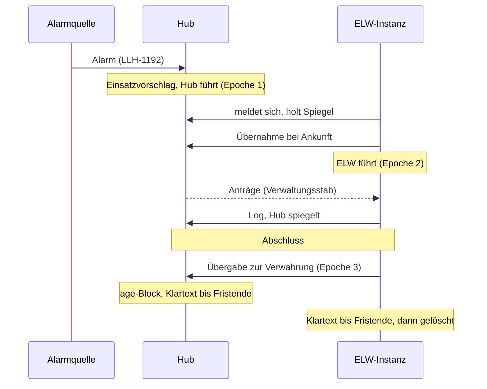
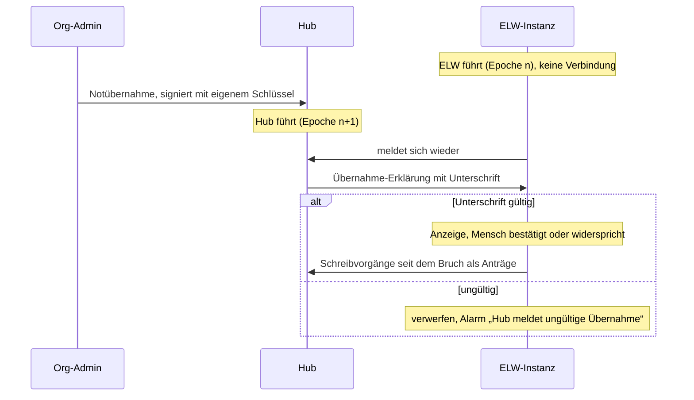

# Instanzkopplung: ELW-Instanz und öffentlicher Hub

Stand: 29.10.2026 · Konzeptnotiz, kein Code · Zunder LLH-1287
(`https://zunder.rubeen.dev/#/aufgabe/x110oeqbspkkomh1s86xzq8p`)

Entstanden im Brainstorming mit Ruben am 29.10.2026, eine Frage nach der anderen. Jede
Entscheidung unten hat er getroffen; die Nummern folgen den Fragen. Begründungen stehen nur, wo
sie für spätere Entwürfe tragen.

## Ausgangslage

- Der Server läuft als genau ein Prozess auf einer SQLite-Datei; Live-Verteilung, Zeremonien und
  Ratenbegrenzung liegen im Prozessspeicher (Risiko R10,
  `docs/architektur/11-risiken-und-technische-schulden.md`). Zwischen zwei Servern gibt es nichts.
- Eine Instanz kennt schon mehrere Organisationen: `org_id` an Einsatz und Audit (LLH-1151,
  `src/AGENTS.md`), Mitgliedschaft mit Schreibrolle über Org-Grenzen.
- Maschinen haben keine Anmeldung; die Gerätekopplung per Code (`src/auth/session.rs`,
  `kopplung_id`) ist das nächste Muster. LLH-1148 (öffentliche API) ist offen.
- Web Push (LLH-1223) hat jede Instanz für sich: VAPID-Schlüssel in der DB, Abos an der Sitzung,
  Schalter `LIFELINE_WEB_PUSH`, Vorgabe aus (`src/web_push/mod.rs`).
- Sicherungen werden schon heute mit age an Empfänger verschlüsselt (`--backup-empfaenger`,
  `docs/betrieb/backup-restore.md`).
- Die Native-Apps-Roadmap (`docs/superpowers/specs/2026-06-18-native-apps-roadmap-design.md`)
  plant Sync Gerät↔Server und langfristig P2P, nicht Server↔Server.

## Begriffe

| Begriff | Bedeutung |
| --- | --- |
| **ELW-Instanz** | Lifeline Hub im Fahrzeug oder am Einsatzort, Hauptarbeitsplatz, oft ohne oder mit wackligem Netz. Keine feste Hardware. |
| **Hub** | Öffentlich erreichbare Lifeline-Hub-Instanz für viele ELW-Instanzen und viele Organisationen. Dieselbe Software. |
| **Führer** | Die eine Instanz, die einen Einsatz gerade schreibt. |
| **Epoche** | Zähler der Führung je Einsatz; jede Übergabe und jede Notübernahme erhöht ihn. |
| **Spiegel** | Lesekopie eines Einsatzes an einer Instanz, die nicht führt. |
| **Antrag** | Schreibwunsch an einer nicht führenden Instanz; „ausstehend“, bis der Führer ihn übernimmt. |
| **Freigabestufe** | Welche Datenkategorien eines Einsatzes gespiegelt werden. |

## Entscheidungen

### Rolle des Hubs

1. **Zweck: alle vier.** Zugang von außen (Verwaltungsstab, Kräfte ohne Einsatz-LAN), Brücke
   nach außen (Alarm-Eingang, Web Push), Archiv und Sicherung, Lagebild für Externe.
7. **Hub für viele.** Ein Hub bedient beliebig viele ELW-Instanzen beliebig vieler
   Organisationen. Jeder Einsatz gehört weiter zu genau einer Org; Org-Grenzen wie heute.
12. **Brücke nur über den Hub.** Ist ein ELW gekoppelt, laufen Alarm-Eingang (LLH-1192/1193)
    und Web Push (LLH-1223) nur über den Hub. Ein Alarm wird am Hub zum Einsatzvorschlag (der
    Hub führt, der ELW übernimmt bei Ankunft); Pushs für Ereignisse eines ELW versendet der Hub.
    Ungekoppelte Instanzen bleiben, wie sie heute sind.

### Führung

2. **Genau ein Führer je Einsatz, die Führung wandert.** Kein Merge. Typischer Lebenslauf:
   Hub führt beim Alarm → ELW führt ab Ankunft → Hub verwahrt nach Abschluss.
3. **Nicht-Führer lesen und stellen Anträge.** Ein Antrag zeigt „ausstehend“, bis der Führer ihn
   übernommen hat; ohne Netz bleibt er ausstehend (Muster wie die Schreib-Warteschlange ohne
   Netz, LFH-705, `frontend/src/offline/AGENTS.md`).
4. **Notübernahme mit Epoche.** Ist der Führer nicht erreichbar, darf eine andere Instanz nach
   ausdrücklicher Bestätigung eines Menschen übernehmen; die Epoche steigt. Beim Wiederverbinden
   gilt die höhere Epoche. Was die abgelöste Instanz seit dem Bruch geschrieben hat, kommt beim
   neuen Führer als Anträge an: nichts geht verloren, nichts wird still gemischt. Gilt in beide
   Richtungen.
9. **Die Befugnis zur Notübernahme kommt von einem Menschen, nie vom Hub.**
   - Eine Notübernahme gegen einen ELW trägt die Unterschrift eines Org-Admins mit eigenem
     Schlüssel (z. B. Passkey: die WebAuthn-Assertion signiert eine Challenge, die den Hash der
     Übernahme-Erklärung enthält). Der Hub reicht sie nur durch.
   - Der ELW prüft sie gegen die beim Koppeln hinterlegten Org-Admin-Schlüssel. Gültig: Anzeige
     „Führung wurde übernommen, von wem, wann, warum“, und ein Mensch am ELW bestätigt oder
     widerspricht. Bis dahin arbeitet der ELW lokal weiter; **der ELW gibt nie still ab.**
     Ungültig: verwerfen und Alarm „Hub meldet ungültige Übernahme“.
   - Fallback ohne Admin-Schlüssel: Einmal-Code, der außerhalb des Hubs übermittelt wird (Funk,
     Telefon).
   - Folge: Ein kompromittierter Hub kann laufende Einsätze lesen, aber keine Führung fälschen.

### Daten

5. **Voller Spiegel im laufenden Einsatz**, gleiche Rollen und Rechte wie lokal. Der Hub ist
   damit genauso schützenswert wie der ELW. Das Lagebild für Externe ist eine geschwärzte
   **Ansicht** auf denselben Spiegel, keine eigene Kopie.
14. **Freigabestufe im Protokoll, gebaut wird zuerst „alles“.** Jeder gespiegelte Datensatz
    trägt seine Kategorie, der Einsatz eine Stufe (etwa „nur Lagebild“, „ohne Art.-9-Daten“,
    „alles“). Sparsamere Stufen kommen später ohne Protokollbruch. Die Notübernahme zeigt an,
    wenn die Stufe nicht alles gespiegelt hat.
11. **Lebensende.** Nach dem Abschluss liegt der Einsatz am Hub als age-verschlüsselter Block
    (Schlüssel bei der Org, der Hub kann ihn nicht lesen). Der Klartext bleibt an Hub und ELW
    eine einstellbare Nachbereitungsfrist lesbar, danach löschen beide.
10. **Stammdaten führt der Hub.** Konten und Rollen, Fahrzeuge und Einheiten, Kataloge,
    Org-Einstellungen werden am Hub gepflegt und an die gekoppelten ELW der Org verteilt. Ein
    ELW darf lokal ergänzen (Spontanhelfer, geliehenes Fahrzeug): gilt sofort lokal, geht als
    Antrag an den Hub. Das Konto ist geteilt, die **Anmeldung bleibt je Instanz** (Passkeys
    hängen an `LIFELINE_WEBAUTHN_RP_ID`), und am ELW muss sie ohne Netz gehen.

| Ebene | Führer | Alle anderen |
| --- | --- | --- |
| Einsatz | wandert, Epoche | Spiegel + Anträge |
| Org-Stammdaten | Hub | Kopie + lokale Ergänzung als Antrag |

### Verbindung und Vertrauen

6. **Die Instanz meldet sich beim Führer, nie umgekehrt.** Der ELW baut die Verbindung selbst
   auf (ausgehend, durch NAT); ein Overlay-Netz (WireGuard, Tailnet) ist erlaubt, ändert aber
   nur den Transport, nicht das Protokoll. Der Hub verlässt sich nie darauf, einen ELW zu
   erreichen. Nachholen über die Position im Log.
13. **Das Gegenüber ist irgendein gekoppelter Führer.** Das Protokoll unterscheidet nicht
    zwischen Hub und ELW: Zwei ELW im selben LAN ohne Internet können später direkt
    miteinander sprechen (Nicht-Führer liest und stellt Anträge beim führenden ELW), geprüft an
    denselben Schlüsseln. Gebaut wird zuerst nur ELW→Hub. Erster Schritt zur P2P-Linie der
    Native-Apps-Roadmap.
8. **Schlüsselpaar je Instanz.** Einstieg per Einmal-Code, den ein Org-Admin am Hub erzeugt (wie
   die Gerätekopplung); dabei tauschen beide Seiten ihren Instanz-Schlüssel, und der ELW bekommt
   die Org-Admin-Schlüssel (Entscheidung 9). Jede Nachricht ist signiert; mTLS mit demselben
   Schlüssel ist ein optionaler Aufsatz für Organisationen mit eigener CA. Die Kopplung ist an
   eine oder mehrere Orgs gebunden, Widerruf an beiden Seiten, Audit in `admin_audit`.
   **Ein Verfahren für alle Maschinen:** Die Instanzkopplung legt es fest, LLH-1148 übernimmt
   es für Fremdsysteme (z. B. als OAuth2 `private_key_jwt`).

## Abläufe

### Lebenslauf eines Einsatzes

### Notübernahme durch den Hub

## Bezüge

- **LLH-1148 (öffentliche API):** übernimmt das Schlüssel-Verfahren aus Entscheidung 8; „Verhalten
  bei mehreren Instanzen“ ist mit diesem Konzept beantwortet (Hub als Eingang).
- **LLH-1223 (Web Push):** bleibt für ungekoppelte Instanzen, wie es ist; ein gekoppelter ELW
  pusht über den Hub (Entscheidung 12).
- **LLH-1192/1193 (Alarm-Eingang, Divera):** der Hub ist der von außen erreichbare Endpunkt; ein
  Alarm wird dort zum Einsatzvorschlag mit dem Hub als Führer.
- **Risiko R10:** bleibt bestehen, auch der Hub ist ein Prozess. Die Kopplung skaliert über
  Instanzen, nicht über Prozesse.

## Offene Fragen

- **Schmale Leitung:** Reihenfolge beim Nachholen (Führung und Anträge vor ETB vor Lage vor
  Anhängen?), Budget bei Satellit, Anhänge verzögert oder nur auf Abruf.
- **Protokollversion:** ELW und Hub laufen in verschiedenen Ständen. Wie weit darf der Abstand
  sein, wer verweigert was?
- **Anmeldung am ELW ohne Netz:** Wie kommt ein Konto aus der Hub-Kopie zu einer lokalen
  Anmeldung (Passwort-Hash mitverteilen, eigener Passkey je ELW, Kopplung des Geräts)?
- **Gleichzeitige Notübernahmen** mit derselben Epoche (zwei Seiten ohne Verbindung): Gleichstand
  über die Instanzkennung oder Pflicht zur menschlichen Klärung?
- **Nachbereitungsfrist:** Vorgabe, wer sie einstellt (Org am Hub?), Verhältnis zur bestehenden
  Aufbewahrung.
- **Archivschlüssel:** Verwahrung bei der Org, Verlust heißt Daten weg; Wiederherstellung und
  Lesen eines Archivs.
- **Mehrere Orgs in einem Einsatz** (Mitgliedschaft über Org-Grenzen): Wessen Hub, wessen
  Freigabestufe?
- **Härtung des Hubs:** er hält Art.-9-Daten im Klartext im Internet. Neues Risiko für Kapitel 11,
  Mindestanforderungen an Betrieb (Kapitel 7, `docs/betrieb/`).
- **Entdeckung im LAN** für ELW↔ELW (mDNS o. ä.).

## Vorschlag für Folgeaufgaben

Schnitt zur Bestätigung; erst danach im Board angelegt. Die tragenden Teile sind Entwürfe (Route
`entwurf`, E1/E3) und bekommen je eine OpenSpec-Change.

1. Instanzkopplung: Schlüsselpaar je Instanz, Einmal-Code, signierte Nachrichten, Widerruf,
   Verteilung der Org-Admin-Schlüssel (Grundlage für LLH-1148).
2. Führung je Einsatz: Epoche, Übergabe, Notübernahme mit Admin-Unterschrift und Code-Fallback,
   Anzeige und Bestätigung am ELW.
3. Spiegel und Anträge: Log-Position, Nachholen, Anträge „ausstehend“, Kategorie und
   Freigabestufe im Datensatz.
4. Stammdaten Hub→ELW: Verteilung, lokale Ergänzung als Antrag, Anmeldung am ELW ohne Netz.
5. Archiv: age-Block am Hub, Nachbereitungsfrist, Löschen an beiden Seiten.
6. Brücke: Alarm-Eingang am Hub als Einsatzvorschlag, Web Push über den Hub für gekoppelte ELW
   (hängt an LLH-1148, LLH-1192, LLH-1223).
7. Lagebild für Externe als geschwärzte Ansicht.
8. Später: ELW↔ELW im LAN.
